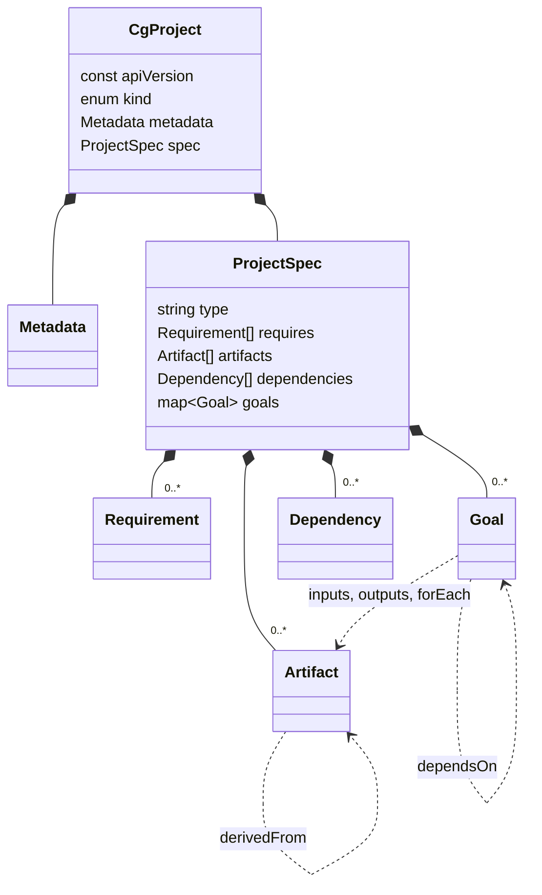

# cgproject schema

Description of [`cgproject.schema.json`](cgproject.schema.json) (`$version` 1.0.0). The design is decided in
portunix-architecture
[ADR-012](https://github.com/cassandragargoyle/portunix-architecture/blob/main/docs/adr/ADR-012-cgproject-project-manifest.md),
the contract is issue [#109](../../docs/issues/109-cgproject-schema.md).

A project manifest `<name>.cgproject.jsonc` says what belongs to a project and what can be done with it, similar
to a Visual Studio project or a Maven POM. A project is a general unit of work: a building energy assessment is a
project in the same way as a Python library.

- **Artifacts are references, not data.** The data stays in its own files and contracts (VIM, Modeler, native
  build files)
- **Native tools stay the source of truth.** A software project references `pyproject.toml` or a `Makefile` as a
  `build-descriptor` artifact, and its goals call their targets
- **The file is the source of truth.** A database (Synapse Project Registry) is only an index built from the files

## Files

| File | `kind` | Content |
| ---- | ------ | ------- |
| `<name>.cgproject.jsonc` | `Project` | One project; the recommended name is `<metadata.id>.cgproject.jsonc` |
| `<name>.cgworkspace.jsonc` | `Workspace` | A group of projects; the `spec` of a workspace is not defined in version 1 |

JSONC is the authoring format, so a manifest can have `//` and `/* */` comments. The schema checks the document
after the comments are removed. Trailing commas are not allowed. JSON or BSON is the storage format in a database.

## Structure

```text
apiVersion     portunix.ai/v1
kind           Project | Workspace
metadata       id, name, description, version | versionFrom, language, repository, product
spec           (kind Project)
  type           label of the project kind
  requires[]     plugin | package, version, optional
  artifacts[]    id, type, path, url, title, layer, template, contract, derivedFrom, optional, extra fields
  dependencies[] project, url, use, artifacts
  goals{}        <name>: run | task, description, forEach, inputs, outputs, dependsOn
```



## Field reference

An **id** (`metadata.id`, artifact `id`, goal name and every reference to them) has letters, digits, `.`, `_`
and `-`, and starts with a letter or a digit. A **kebab-case name** (`spec.type`, artifact `type`, `layer`,
`contract`) is lowercase, for example `vim-document`.

### Root

| Field | Type | Required | Notes |
| ----- | ---- | :------: | ----- |
| `$schema` | uri | | `https://cassandragargoyle.org/schemas/cgproject.schema.json`, for editors |
| `apiVersion` | const | ✅ | `portunix.ai/v1` |
| `kind` | enum | ✅ | `Project` \| `Workspace` |
| `metadata` | Metadata | ✅ | Identity of the project |
| `spec` | object | ✅ | A ProjectSpec for `kind: Project`; any object for `kind: Workspace` |

### Metadata

Closed object. `tenantId` and `workspaceId` are not allowed, because they belong to the deployment; the file
stays portable between tenants.

| Field | Type | Required | Notes |
| ----- | ---- | :------: | ----- |
| `id` | id | ✅ | Stable id; other projects refer to it in `dependencies[].project` |
| `name` | string | ✅ | Human-readable name |
| `description` | string | | Short description |
| `version` | string | | Version of the project; not together with `versionFrom` |
| `versionFrom` | id | | Id of the `build-descriptor` artifact that holds the version; not together with `version` |
| `language` | string | | BCP 47 tag of the project content, for example `cs-CZ`, `en` |
| `repository` | uri | | URL of the source repository |
| `product` | id | | Id of a [product](product.schema.json) document |

### ProjectSpec

Closed object, no field is required.

| Field | Type | Notes |
| ----- | ---- | ----- |
| `type` | kebab-case | Label of the project kind (`building-energy`, `software`); prescribes no artifacts in version 1 |
| `requires` | Requirement[] | Plugins and packages that portunix installs before the goals run |
| `artifacts` | Artifact[] | Typed references to the parts of the project |
| `dependencies` | Dependency[] | Other projects that this project uses |
| `goals` | object of Goal | Named operations, keyed by goal name (an id) |

### Requirement

Closed object with exactly one of `plugin` or `package`. Dependencies that a native build file already lists (for
example the Python dependencies in `pyproject.toml`) are not repeated.

| Field | Type | Notes |
| ----- | ---- | ----- |
| `plugin` | string | Name of a Portunix plugin, for example `crawler` |
| `package` | string | Name of a package that portunix installs, for example `uv` |
| `version` | string | Version or range, for example `>=3.12` |
| `optional` | boolean | The goals can run without it (default `false`) |

### Artifact

The core fields are fixed; extra fields per type are allowed (for example `format`, `language`, `published`).

| Field | Type | Required | Notes |
| ----- | ---- | :------: | ----- |
| `id` | id | ✅ | Unique in the project |
| `type` | kebab-case | ✅ | Open type, see the known values below |
| `path` | string | | File or directory relative to the manifest; can contain `{metadata.<field>}` |
| `url` | uri | | Remote location, for example the origin of a downloaded source |
| `title` | string | | Human-readable title |
| `layer` | kebab-case | | VIM layer of a `vim-document`, for example `prescriptive`, `extraction` |
| `template` | string | | Template, for example the VIM extraction template `building-facts` |
| `contract` | kebab-case | | Api contract of the artifact, for example `plugin-manifest` |
| `derivedFrom` | id[] | | Artifacts that this artifact is made from; at least one item |
| `optional` | boolean | | The project is complete without it (default `false`) |

Known values of `type`. A tool ignores a type it does not know, as a VIM reader ignores an unknown layer. A new
value is added to this list when two projects use it.

| Type | Meaning |
| ---- | ------- |
| `source` | Downloaded or written source text, for example a law |
| `vim-document` | VIM document (`*.vim.json`), with `layer` and optional `template` |
| `modeler-model` | Modeler model (`*.model.json`) |
| `build-descriptor` | Native build file, for example `pyproject.toml`, `pom.xml`, `Makefile` |
| `source-tree` | Directory with source code or document sources |
| `test-tree` | Directory with tests |
| `plugin-manifest` | Portunix plugin manifest |
| `task-manifest` | Task Platform task manifest |
| `dataset` | Data that the project uses but does not build |
| `model` | Trained model |
| `package` | Built package, for example a wheel |
| `document` | Built document, for example a PDF book |
| `assessment` | Result of an assessment |

Building facts (address, operator, areas, energy class) are not a separate contract. They are a `vim-document`
with the `extraction` layer and the `building-facts` template (ADR-012, decision 5).

### Dependency

Closed object. The workspace resolves `project` to a local path. Versions of dependencies are not part of
version 1, so `version` is rejected.

| Field | Type | Required | Notes |
| ----- | ---- | :------: | ----- |
| `project` | id | ✅ | `metadata.id` of the other project |
| `url` | uri | | Location of the project outside the workspace |
| `use` | string | | What is used, for example `contracts` |
| `artifacts` | string[] | | Names of the used parts, for example contract names |

### Goal

Closed object with exactly one of `run` or `task`.

| Field | Type | Notes |
| ----- | ---- | ----- |
| `run` | string | Command line, for example `make test` |
| `task` | string | Task type of the Task Platform, for example `vim-parser.prescriptive`; the task gets its artifacts as structured input |
| `description` | string | Human-readable description |
| `forEach` | object | Artifact filter, at least one field: the goal runs once per artifact whose fields equal all the values; `*` matches any value of a field that the artifact has |
| `inputs` | id[] | Artifacts that the goal reads |
| `outputs` | id[] | Artifacts that the goal writes |
| `dependsOn` | id[] | Goals that run before this goal |

## Placeholders

Strings can contain only two kinds of placeholders. There are no expressions.

| Placeholder | Where | Value |
| ----------- | ----- | ----- |
| `{artifact.<field>}` | `run` of a goal with `forEach` | Field of the current artifact, for example `{artifact.path}` |
| `{metadata.<field>}` | Any string | Field of `metadata`; `{metadata.version}` is resolved through `versionFrom` when there is no `version` |

The schema describes the placeholders but does not parse them.

## What the schema does not check

These rules are for the tools that read the manifest. A later extra check of `make validate-contract` can add them.

- Artifact ids are unique in the project
- `derivedFrom`, `inputs`, `outputs`, and `versionFrom` refer to existing artifacts
- `dependsOn` refers to existing goals and the goals have no cycle
- `versionFrom` refers to a `build-descriptor` artifact
- A known artifact type has the fields that it needs, for example `layer` for a `vim-document`

## Examples

| Example | Content |
| ------- | ------- |
| [epbd-od-dvorak.cgproject.jsonc](../examples/epbd-od-dvorak.cgproject.jsonc) | Building energy assessment: sources, VIM prescriptive documents, building facts, an assessment result |
| [portunix-reco.cgproject.jsonc](../examples/portunix-reco.cgproject.jsonc) | Software project: build descriptors, plugin manifests, data sets, a wheel, a book, a project dependency |
| [cassandragargoyle.cgworkspace.jsonc](../examples/cassandragargoyle.cgworkspace.jsonc) | Workspace with an empty `spec` |
| [invalid/cgproject-*](../examples/invalid/) | Negative tests: one small project with one defect each |
