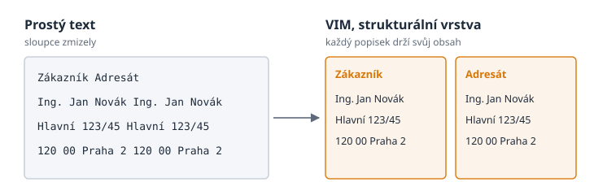

# Kdo je zákazník?

> Český překlad [00-who-is-the-customer.md](00-who-is-the-customer.md). Anglická verze je autoritativní.

## Jedna otázka, položená dvakrát

Poslední lednový den roku 2026 položil někdo z týmu jazykovému modelu velmi jednoduchou
otázku nad vyúčtováním elektřiny: *kdo je na tomto dokumentu zákazník?*

Člověku stačí na odpověď půl vteřiny. Jméno stojí přímo tam, pod slovem *Zákazník*, v levém
horním rohu stránky. Vedle, ve druhém sloupci, je slovo *Adresát* a pod ním totéž jméno a
tatáž adresa. Každé dítě, které umí číst, by ukázalo na správný blok.

Model dostal dokument jako prostý text, tak jak ho většina nástrojů z PDF dodnes předává:
řádek za řádkem, od horního okraje stránky k dolnímu. Chvíli četl a pak odpověděl poctivě.
Zákazníka podle něj *nelze s jistotou určit*. Existuje kandidát, jakýsi Ing. Jan Novák, ale
vztah k popisku není výslovný. První řádek textu zněl *„Zákazník Adresát“*: dvě záhlaví
sloupců se slila do jednoho řádku. O sto řádků níž se jméno objevilo dvakrát na jednom
řádku a adresa také. Dva sloupce stránky se zploštily do jednoho proudu slov. Jistota
odpovědi: **nízká**.

O několik minut později dostal tentýž model tutéž otázku nad tímtéž vyúčtováním. Tentokrát
přišel dokument jako soubor `vim.json`. Odpověď byla krátká: Ing. Jan Novák, s adresou, a
jistota **vysoká**. Model k tomu vysvětlil proč. V souboru byl blok typu `labeled_content`
se záhlavím *Zákazník* a se jménem pod ním a vedle samostatný blok se záhlavím *Adresát*. O
vrstvu výš ležela entita typu `customer`, která ukazovala zpět na první blok. Nic se nemuselo
hádat.



Oba výsledky jsou dodnes uložené v repozitáři parseru vedle sebe jako první pokus malé
výzkumné aparatury. Nejsou benchmarkem. Jsou jednou otázkou nad jedním anonymizovaným
dokumentem. Na několika řádcích ale ukazují celý důvod, proč tato kniha vznikla.

## Problém není v PDF

Svalit vinu na formát je snadné. PDF je všude a proslulo tím, že se strojově čte špatně.
PDF ale nikdy nemělo nést význam. Adobe ho uvedlo v roce 1993, aby stránka vypadala stejně
na každé obrazovce a na každé tiskárně, a v roce 2008 se z něj stala mezinárodní norma
ISO 32000. Tuto práci dělá velmi dobře. PDF ví, kde stojí každý znak. Neví, že znaky pod
slovem *Zákazník* tvoří jméno, ani že to jméno patří zákazníkovi, a ne adresátovi.

Návrhové poznámky VIM to říkají přímo: *PDF je jen symptom*. Skutečným problémem je
**ztráta významu, když data putují mezi systémy**. Typický řetěz vypadá takto:

```text
DB → reporting tool → PDF → human → manual transcription
```

Na začátku řetězu jsou data dokonalá: databáze přesně ví, která hodnota je zákazník, která
částka a která měna. Pak je reportovací nástroj vytiskne na stránku, stránka putuje k
někomu jinému a na druhé straně musí člověk, nebo dnes program, význam z obrázku znovu
poskládat. Příjemce přitom nechce PDF. Chce hodnoty, vztahy, význam a důkaz, že hodnoty
skutečně pocházejí z tohoto dokumentu.

## Odpovědí není jeden formát

Když se na tento problém díváme poprvé, toužíme po jednom dokonalém formátu, který pojme
všechno. Historie dokumentů říká, že takový neexistuje. Knihovny se se stejnou otázkou
potkaly, když začaly digitalizovat knihy: v červnu 2004 vydal evropský projekt METAe první
verzi formátu ALTO, XML, které zaznamenává, kde na naskenované stránce stojí každé slovo,
řádek a sloupec. ALTO popisuje rozvržení výborně a Kongresová knihovna ho spravuje dodnes.
O tom, co slovo znamená, ale neříká nic. Jiné formáty zase výborně popisují význam a o
stránce nevědí nic.

Návrhové poznámky VIM z toho vyvozují závěr ve dvou větách, kterými celý koncept začíná:

> Neexistuje jeden univerzální formát pro všechny soubory.
> Existuje univerzální vrstvený model pro reprezentaci informace.

Otázka tedy nezní, *který formát uloží všechno*. Zní, *jak uložit výsledek porozumění
souboru*. Odpovědí VIM je stoh vrstev. Nejnižší vrstva říká, co na stránce fyzicky je. Další
říká, jak je to seskupené. Třetí říká, co to znamená. Každá hodnota na každé vrstvě umí
ukázat zpět na soubor, stránku a obdélník, ze kterého pochází, a říká, jak moc si byl stroj
jistý.

## Jméno

VIM je zkratka **Vrstveného informačního modelu**, anglicky *Layered Information Model*.
Model se narodil v českém týmu, na českých fakturách a českých QR platbách, a jméno si svůj
původ ponechalo. V angličtině písmena slovům neodpovídají, a tak kniha používá VIM jako
vlastní jméno, podobně jako lidé říkají PHP nebo GNU a nepřemýšlejí, co písmena kdysi
znamenala. Některé dokumenty ekosystému nějakou dobu rozepisovaly VIM jako *Versatile
Information Model*. Takový rozpis zachoval písmena, ale ztratil podstatu: důležité slovo je
*vrstvený*.

Jméno má ještě jednu malou past. Čtenář, který pracuje s textovými editory, si okamžitě
vybaví editor Vim. Kromě tří písmen nemají nic společného. VIM z této knihy je datový model;
jeho soubory končí příponou `.vim.json` a nikdo se nemusí učit, jak z něj odejít.

## O čem je tato kniha

Kniha vypráví příběh VIM: jak se parser faktur, napsaný během několika horečných dní na
konci ledna 2026, za devět měsíců proměnil ve společný kontejner výsledků celého ekosystému
nástrojů pro dokumenty. Ukazuje, co obsahuje `vim.json`, vrstvu po vrstvě, na skutečném
souboru ze skutečného parseru. Nahlíží do stroje, který ho píše, a na kontrakt v tomto
repozitáři, který každému výrobci i každému čtenáři říká, co smí očekávat. A ukazuje, jak
vyrobit první vlastní `vim.json` a jak ho zkontrolovat.

Další kapitola začíná samotnou myšlenkou: co znamená číst dokument ve vrstvách.

## Prameny

- Výsledky pokusu: `research/results/` pluginu `vim-parser` v repozitáři `portunix-plugins`
  (31. ledna 2026)
- Návrhové poznámky *Universal "Perfect" Format for Storing Information from Any File*,
  `plugins/vim-parser/README.md` v `portunix-plugins`
- [PDF](https://en.wikipedia.org/wiki/PDF): uvedeno firmou Adobe v roce 1993, ISO 32000-1 v
  roce 2008
- [ALTO (XML)](https://en.wikipedia.org/wiki/ALTO_(XML)): verze 1.0 z projektu METAe v
  červnu 2004, od roku 2009 ji spravuje Kongresová knihovna
