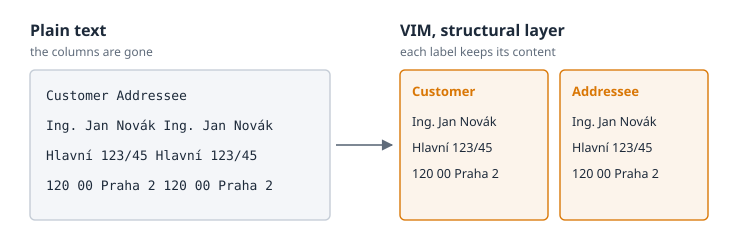

# Who Is the Customer?

## A Question Without a Sure Answer

At the end of January 2026, someone in the team asked a language model a very simple
question about an electricity bill: *who is the customer on this document?* The bill was
in Czech; this edition gives its labels and its anonymized names in English.

A person needs half a second for the answer. The name stands right there, under the word
*Customer*, in the upper left corner of the page. Next to it, in a second column, there is
the word *Addressee*, with the same name and the same address under it. Any child who can
read would point at the right block.

The model got the document as plain text, the way most tools still pass a PDF on: one line
after another, from the top of the page to the bottom. It read for a while and then gave an
honest answer. The customer, it said, *cannot be determined with certainty*. There was a
candidate, a certain John Newman, but the relation to the label was not explicit. The
first line of the text read *"Customer Addressee"*: two column headers had melted into one
line. A hundred lines later, the name appeared twice on one line, and so did the address.
The two columns of the page had been flattened into one stream of words. The confidence of
the answer: **low**.

## From Doubt to a Model

That honest *cannot be determined* is where VIM begins. Nothing was missing from the bill.
Everything a person needs was on the page: the columns, the labels, the name under the
right label. It was lost on the way, when the page became a stream of text. The machine
was not too weak to understand; it had been given too little to understand from.

So the team stopped asking how to make the reader smarter and started asking a different
question: how do we keep what the page shows? The answer was a model that does not flatten
the page. It keeps the text with its position, it keeps the blocks with their labels, and
on top of them it writes what they mean, every value with a pointer back to where it came
from. The team called it VIM, and its first version was written in a few intense days.

Then the same question went to the same model about the same bill once more. This time the
document came as a `vim.json` file. The answer was short: John Newman, with his address,
and the confidence was **high**. The model also explained why. In the file there was a
block of type `labeled_content` with the header *Customer* and the name under it, and a
separate block with the header *Addressee*. A layer above it held an entity of type
`customer` that pointed back to the first block. Nothing had to be guessed.



Both answers are still kept in the repository of the parser, side by side, as the first
experiment of a small research apparatus. They are not a benchmark. They are one question
about one anonymized document. But they show in a few lines what VIM is for.

## The Problem Is Not the PDF

It is easy to blame the format. PDF is everywhere, and it is famous for being hard to read
by machines. But PDF was never meant to carry meaning. Adobe introduced it in 1993 to make
a page look the same on every screen and every printer, and in 2008 it became the
international standard ISO 32000. It does that job very well. A PDF knows where each glyph
stands. It does not know that the glyphs under *Customer* form a name, or that the name
belongs to the customer and not to the addressee.

When the authors of VIM first wrote down their idea, in a short text that this book calls
the *design notes*, they said it plainly: *PDF is just a symptom*. The real problem is the
**loss of semantics when data travels between systems**. A typical chain looks like this:

```text
DB → reporting tool → PDF → human → manual transcription
```

At the start of the chain the data is perfect: a database knows exactly which value is the
customer, which is the amount and which is the currency. Then a reporting tool prints it on
a page, the page travels to someone else, and on the other side a person, or today a
program, has to rebuild the meaning from the picture. What the receiver wants is not the
PDF. The receiver wants values, relations, meaning, and proof that the values really come
from this document.

## The Answer Is Not One Format

When we look at this problem for the first time, we want one perfect format that holds
everything. The history of documents says it does not exist. Libraries met the same
question when they began to digitize books: in June 2004 the EU project METAe released the
first version of ALTO, an XML format that records where each word, line and column stands
on a scanned page. ALTO describes the layout very well, and the Library of Congress
maintains it to this day. But it says nothing about what a word means. Other formats
describe meaning very well and know nothing about the page.

The design notes put the conclusion into two sentences, and the whole idea of VIM starts
with them:

> There is no single universal format for all files.
> There is a universal layered model for information representation.

The question is therefore not *which format stores everything*. The question is *how to
store the result of understanding a file*. The answer of VIM is a stack of layers. The
lowest layer says what is physically on the page. The next one says how it is grouped. The
third one says what it means. Every value on every layer can point back to the file, the
page and the rectangle it came from, and it says how sure the machine was.

## The Name

VIM is short for **Vrstvený informační model**, Czech for *Layered Information Model*. The
model was born in a Czech team, on Czech invoices and Czech payment QR codes, and the name
kept its origin. In English the letters do not fit the words, so the book uses VIM as a
proper name, the way people say PHP or GNU without thinking of what the letters once meant.
For a while some documents of the ecosystem expanded VIM as *Versatile Information Model*.
That expansion kept the letters and lost the point: the important word is *layered*.

The name has one more small trap. A reader who works with text editors will think of the
editor Vim at once. The two have nothing in common except three letters. The VIM of this
book is a data model; its files end with `.vim.json`, and nobody has to learn how to exit
it.

## Why This Book

VIM was built by a small team for its own tools, and for months its idea lived in source
code, architecture decisions and the heads of a few people. But the question of the
customer is not a question of one team. Anyone who passes documents to a machine, or to a
language model, meets it sooner or later. This book exists so that the idea of VIM can
reach more people than the few who built it: the idea that a document should not be
flattened, but read in layers, with every value able to say where it came from.

The book tells the story of VIM: how a parser for invoices, written at the end of January
2026, grew within nine months into the shared result container of a whole ecosystem of
document tools. It shows what a `vim.json` contains, layer by layer, on a real file
produced by the real parser. It looks inside the machine that writes it, and at the
contract in this repository that tells every producer and every reader what they may
expect. And it shows how to make your first `vim.json` and how to check it.

The next chapter starts with the idea itself: what it means to read a document in layers.

## Sources

- Research results of the experiment: `research/results/` of the `vim-parser` plugin in the
  `portunix-plugins` repository (31 January 2026)
- Design notes *Universal "Perfect" Format for Storing Information from Any File*,
  `plugins/vim-parser/README.md` in `portunix-plugins`
- [PDF](https://en.wikipedia.org/wiki/PDF): introduced by Adobe in 1993, ISO 32000-1 in 2008
- [ALTO (XML)](https://en.wikipedia.org/wiki/ALTO_(XML)): version 1.0 by the METAe project
  in June 2004, maintained by the Library of Congress since 2009
