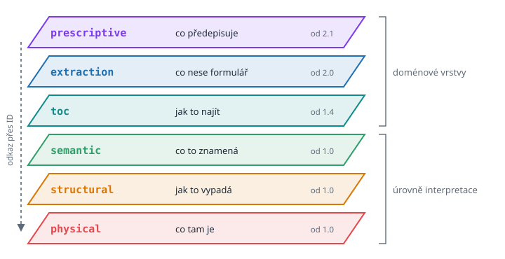

# Skleněné tabule

> Český překlad [01-sheets-of-glass.md](01-sheets-of-glass.md). Anglická verze je autoritativní.

## Čtení není jeden úkon

Pozorujte člověka, který poprvé čte fakturu. Oči neběží od prvního písmene k poslednímu.
Nejdřív vezmou stránku jako obraz: tučný řádek nahoře, dva bloky textu vedle sebe, tabulka,
černý čtverec v rohu. Pak seskupují: tento blok je dodavatel, tamten odběratel, tahle mřížka
je seznam položek. Teprve potom přichází význam: číslo vpravo dole je celková částka, v
korunách, a černý čtverec je QR kód, kterým se dá faktura zaplatit.

Nebo pozorujte téhož člověka nad stránkou řádkové inzerce v novinách. Desítky drobných
inzerátů stojí v úzkých sloupcích jeden za druhým: pronájem bytu, ojeté kolo, ztracená
kočka. Mezi nimi jsou zarámované reklamy tučným písmem, malá fotografie auta, logo obchodu,
tenká linka, která odděluje jednu rubriku od druhé. Ani tuto stránku oči nečtou řádek po
řádku. Nejdřív uvidí sloupce, rámečky a obrázky. Pak seskupují: tyto čtyři řádky jsou
jeden inzerát, tento rámeček je reklama, a ne inzerát, tento obrázek patří k autu pod ním,
tento nadpis otevírá rubriku bytů. Teprve potom přichází význam: cena, telefonní číslo,
velikost bytu. Stroj, který by stránku četl zleva doprava a shora dolů, by smíchal konec
jednoho inzerátu se začátkem dalšího a slogan reklamy by vložil doprostřed telefonního
čísla.

Čtení není jeden úkon. Jsou to nejméně tři a každý stojí na tom pod ním. Chceme-li, aby stroj
výsledek čtení uchoval, je přirozené uchovat všechny tři a držet je od sebe. Představte si
tři skleněné tabule položené přes stránku. Na nejspodnější obtáhnete, co tam opravdu je. Na
druhé orámujete, co k sobě patří. Na horní napíšete, co to znamená. Každou tabuli lze
zvednout a prohlédnout samotnou a každá značka na vyšší tabuli leží přesně nad značkami, ze
kterých vznikla.

Tento obraz je VIM.

## Pět principů

Ještě před prvním řádkem kódu sepsali autoři VIM pět pravidel, která musí dobrý výsledek
čtení splňovat. Vyplatí se je číst pomalu, protože každé pozdější rozhodnutí o formátu se
k některému z nich vrací.

**Odděl obsah, strukturu a význam.** Text `123 456` je obsah. To, že leží v buňce, ve
sloupci, v tabulce, je struktura. To, že jde o částku bez DPH v korunách, je význam. Tři
různé věci, uložené na třech různých místech.

**Buď vrstvený.** Jedna vrstva nikdy nestačí. Poznámky to shrnují krátkým řetězem: surová
data, rozvržení, struktura, sémantika. Model, který uchová jen poslední krok, zahodí důkazy;
model, který uchová jen první krok, nechá veškerou práci na čtenáři.

**Uchovej původ.** Každá hodnota musí umět říct, odkud pochází: z jakého souboru, z jaké
stránky, z jaké oblasti stránky. Bez toho je hodnota jen pověst.

**Buď obousměrný.** Z modelu musí jít počítat, třeba sečíst částky faktur za celý rok. A z
modelu musí jít dokument alespoň přibližně zrekonstruovat. Jedna z dalších kapitol ukazuje
stránku faktury překreslenou jen z jejího `vim.json`.

**Počítej s nejistotou.** Žádný stroj nečte dokument se stoprocentní jistotou. Proto každý
výsledek nese spolehlivost, metodu, která ho vytvořila, a tam, kde to dává smysl, i
alternativy, které byly zváženy a odmítnuty.

## Tři otázky

První tři vrstvy VIM odpovídají na tři otázky a jejich jména jsou dost krátká, aby se dala
zapamatovat:

| Vrstva | Otázka | Co obsahuje |
| ------ | ------ | ----------- |
| `physical` | Co tam je? | Text s přesnou polohou a písmem, čárové kódy, tabulky, grafiku, plný text |
| `structural` | Jak to vypadá? | Bloky se záhlavím a tělem, jejich typ a důležitost, čárové kódy s bloky v okolí |
| `semantic` | Co to znamená? | Entity jako zákazník nebo dodavatel, platby přečtené z QR kódů, kmeny slov pro vyhledávání |

Pořadí odpovídá hloubce interpretace. Fyzická vrstva neinterpretuje téměř nic: říká, že
řetězec *Odběratel* stojí tučně na určitém místě. Strukturální vrstva interpretuje trochu:
říká, že tento tučný řetězec je záhlavím bloku se třemi řádky pod ním. Sémantická vrstva
interpretuje nejvíc: říká, že blok popisuje zákazníka, a říká to se spolehlivostí 0,8, ne
1,0.

Každá vyšší vrstva odkazuje na nižší stabilním identifikátorem, místo aby ji kopírovala.
Strukturální blok `block_4` má stejné ID jako fyzický blok, ze kterého vznikl. Sémantická
entita říká `source_block: block_4`. To je ta značka na horní skleněné tabuli, která leží
přesně nad značkou pod ní.

## Co se stalo se čtvrtou vrstvou

Původní návrhové poznámky měly čtvrtou vrstvu: *Původ a důvěra*, s otázkou *proč tomu
věříme?* Měla obsahovat zdroj, stránku, obdélník, spolehlivost a metodu každé hodnoty.

Když se formát stavěl, samostatnou tabulí se tato vrstva nestala. Stalo se z ní něco
lepšího: vlastnost každého prvku na každé tabuli. Textový prvek ve fyzické vrstvě nese svůj
`bbox`, svou `page` a svou `confidence`. Strukturální čárový kód nese ID bloků ve svém okolí
a spolehlivost. Sémantická entita nese ID zdrojového bloku a spolehlivost. Původ není místo,
kam se chodí; cestuje s každou hodnotou. Spotřebitel nikdy nemusí spojovat dvě vrstvy, aby
zjistil, odkud se číslo vzalo.

## Vrstvy, které přišly později

Tři úrovně interpretace jsou uzavřená množina. Čtvrtá úroveň interpretace by změnila
základní myšlenku VIM a architektonická rozhodnutí ekosystému to říkají výslovně. Na
dokument se ale dá dívat nejen hlouběji, ale i z jiné strany. Postupně tak VIM dostal tři
další vrstvy jiného druhu, **doménové vrstvy**:

| Vrstva | Od verze | Otázka | Výrobce |
| ------ | -------- | ------ | ------- |
| `toc` | 1.4 | Jak v něm věci najdu? | vim-parser |
| `extraction` | 2.0 | Co nese tento formulář? | rozpoznávání formulářů (reco) a další |
| `prescriptive` | 2.1 | Co tento dokument předepisuje? | výrobce s jazykovým modelem, kontrolovaný člověkem |

Doménová vrstva neinterpretuje stránku hlouběji. Drží pohled postavený pro jeden účel:
orientaci v dlouhé knize, hodnoty vyplněného formuláře, pravidla zapsaná ve specifikaci.
Každá doménová vrstva odkazuje na úrovně interpretace přes ID, takže kotvy zůstávají na
jednom místě.

Všechny vrstvy jsou volitelné. Dokument ze skeneru obrázků může mít jen vrstvu
`extraction`. Dlouhá kniha v PDF může mít `physical`, `structural` a `toc`. Čtenář vrstvy,
které nezná, ignoruje. Právě to dovoluje velmi rozdílným nástrojům sdílet jeden kontejner,
aniž by si šlapaly na prsty.

## Vrstvy starší než počítače

Bylo by snadné myslet si, že vrstvy nad dokumentem jsou vynálezem počítačové doby. Nejsou.
Otevřete téměř jakoukoli knihu a podívejte se na její první stránky. Ještě před první
kapitolou vám autor nebo nakladatel řekne, o čem kniha je, jak je rozdělená a kde najdete
kterou část. Tento krátký text není obsahem knihy. Je to popis, který stojí nad obsahem a
ukazuje do něj: vrstva.

Ta myšlenka je velmi stará. Kolem roku 77 věnoval římský spisovatel Plinius starší svou
*Přírodní historii* budoucímu císaři Titovi. Dílo mělo třicet sedm knih a Plinius celou
první knihu vyhradil přehledu ostatních: seznamu obsahu každé knihy, aby zaneprázdněný
čtenář našel téma, aniž by musel číst všechno. Vedle obsahu vyjmenoval autority, ze kterých
čerpal, v dochovaných seznamech přes čtyři sta jmen. Obsah a seznam pramenů v jedné knize,
napsané téměř před dvěma tisíci lety. Řečeno slovy této knihy: vrstva `toc` a původ.

Pozdější staletí přidala další vrstvy téhož druhu. V Anglii se abecední rejstříky na konci
knih objevily koncem šestnáctého století; rejstřík vytištěný roku 1595 v překladu
Plútarchových *Životopisů* od Thomase Northe patří k raným příkladům. Roku 1658 končila
kniha parlamentních zákonů *Abecední tabulkou nejpodstatnějšího obsahu celé knihy*.
Rejstřík je malá sémantická vrstva: říká, které stránky jsou o které myšlence, a na místo
ukazuje číslem stránky, tak jako entita VIM ukazuje na svůj blok.

Ten zvyk žije dodnes. Česká kniha o člověku v době umělé inteligence, vydaná roku 2025,
začíná úvodem, ve kterém autor provede čtenáře všemi sedmi kapitolami, jednou po druhé,
dřív než první z nich začne.

VIM tyto vrstvy nevymyslel. Dává jim tvar, který umí stroj zapsat, přečíst a zkontrolovat,
a přidává, co tištěný rejstřík nikdy neměl: spolehlivost každé položky a metodu, která ji
vytvořila.

## Model, ne formát souboru

V návrhových poznámkách je ještě jedna myšlenka, kterou je snadné přehlédnout. *Dokonalý
formát*, říkají poznámky, není jedna věc, ale **pipeline plus datový model**. VIM je ten
model. Určuje, jak vypadá výsledek porozumění dokumentu. Neurčuje, jak porozumění probíhá.
Jeden nástroj čte text přímo z PDF, druhý pouští OCR na sken, třetí se zeptá jazykového
modelu. Všechny píší stejné vrstvy a každá hodnota říká, jaká metoda ji vytvořila.

Proto také mohl VIM růst tak rychle. Jeho první verze vznikla pro faktury v PDF. Během
několika měsíců nesl výsledky rozpoznávání formulářů z naskenovaných obrázků i požadavky
technických specifikací. Model nemusel měnit svou myšlenku; stačilo mu přidat nové skleněné
tabule. Jak se to stalo a v jakém pořadí, vypráví další kapitola.

## Prameny

- Návrhové poznámky *Universal "Perfect" Format for Storing Information from Any File*,
  `plugins/vim-parser/README.md` v `portunix-plugins`
- Specifikace formátu VIM v1.5 a v2.0, `docs/architecture/` v `portunix-architecture`
- ADR-009 *Criteria for Adding a New VIM Layer* (9. října 2026), `portunix-architecture`
- [Natural History (Pliny)](https://en.wikipedia.org/wiki/Natural_History_(Pliny)): první
  kniha jako předmluva, seznam obsahu a seznamy autorit; první knihy napsány roku 77
- Lukáš Sedláček, *Nazí v AI době* (2025, ISBN 978-80-53061-04-9), úvod, strany 13 až 16
- [Index (publishing)](https://en.wikipedia.org/wiki/Index_(publishing)): rané rejstříky v
  anglických knihách, Northův Plútarchos (1595) a Scobellovy *Acts and Ordinances of
  Parliament* (1658)
