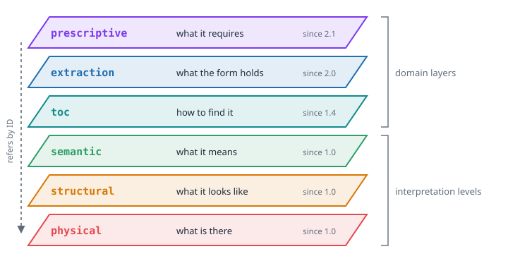

# Sheets of Glass

## Reading Is Not One Act

Watch a person who reads an invoice for the first time. The eyes do not run from the first
letter to the last. They first take in the page as a picture: a bold line at the top, two
blocks of text side by side, a table, a black square in a corner. Then they group: this
block is the supplier, that one is the customer, this grid is the list of items. Only then
comes meaning: the number at the bottom right is the total, in Czech crowns, and the black
square is a QR code with which the bill can be paid.

Reading is not one act. It is at least three, and each one stands on the one below it. If
we want a machine to keep the result of reading, it is natural to keep all three, and to
keep them apart. Imagine three sheets of glass laid over the page. On the lowest one, you
trace what is really there. On the second one, you draw frames around what belongs
together. On the top one, you write what it means. Each sheet can be lifted and looked at
alone, and each mark on a higher sheet stands exactly over the marks it was made from.

This picture is VIM.

## Five Principles

The design notes of VIM name five principles. They are worth reading slowly, because every
later decision in the format goes back to one of them.

**Separate content, structure and meaning.** The text `123 456` is content. The fact that
it sits in a cell, in a column, in a table, is structure. The fact that it is a net amount
in Czech crowns without VAT is meaning. Three different things, stored in three different
places.

**Be layered.** One layer is never enough. The notes put it as a short chain: raw, layout,
structure, semantics. A model that keeps only the last step throws away the evidence; a
model that keeps only the first step leaves all the work to the reader.

**Preserve provenance.** Every value must be able to say where it came from: which file,
which page, which region of the page. Without that, a value is a rumour.

**Be bidirectional.** From the model, a program must be able to compute: sum the totals of
a year of invoices, for example. And from the model, the document must be at least roughly
reconstructable. A later chapter shows a page of an invoice redrawn from nothing but its
`vim.json`.

**Handle uncertainty.** No machine reads a document with full certainty. So every result
carries a confidence, the method that produced it and, where it makes sense, the
alternatives that were considered and rejected.

## The Three Questions

The first three layers of VIM answer three questions, and their names are short enough to
remember:

| Layer | Question | What it holds |
| ----- | -------- | ------------- |
| `physical` | What is there? | Text with exact positions and fonts, barcodes, tables, graphics, the full text |
| `structural` | What does it look like? | Blocks with a label and a body, their type and importance, barcodes with the blocks near them |
| `semantic` | What does it mean? | Entities such as a customer or a supplier, payments read from QR codes, word stems for search |

The order is the depth of interpretation. The physical layer interprets almost nothing: it
says that the string *Odběratel* stands at a certain position in bold. The structural layer
interprets a little: it says that this bold string is the label of a block with three lines
under it. The semantic layer interprets the most: it says that the block describes the
customer, and it says so with a confidence of 0.8, not 1.0.

Each higher layer refers to the lower one by a stable identifier instead of copying it. A
structural block `block_4` has the same ID as the physical block it was made from. A
semantic entity says `source_block: block_4`. That is the mark on the upper sheet of glass
standing exactly over the mark below.

## What Happened to the Fourth Layer

The original design notes had a fourth layer: *Provenance and trust*, with the question
*why do we believe it?* It was meant to hold the source, the page, the rectangle, the
confidence and the method of every value.

When the format was built, this layer did not become a separate sheet. It became something
better: a property of every element on every sheet. A text element in the physical layer
carries its `bbox`, its `page` and its `confidence`. A structural barcode carries the IDs of
the blocks near it and a confidence. A semantic entity carries the ID of its source block
and a confidence. Provenance is not a place you go to; it travels with each value. A
consumer never has to join two layers to learn where a number came from.

## Layers That Came Later

The three interpretation levels are a closed set. A fourth level of interpretation would
change the core idea of VIM, and the architecture decisions of the ecosystem say so
explicitly. But a document can be seen not only deeper, but also from another side. Over
time, VIM got three more layers of a different kind, the **domain layers**:

| Layer | Since | Question | Producer |
| ----- | ----- | -------- | -------- |
| `toc` | 1.4 | How do I find things in it? | vim-parser |
| `extraction` | 2.0 | What does this form hold? | form recognition (reco) and others |
| `prescriptive` | 2.1 | What does this document require? | an LLM-based producer, checked by a person |

A domain layer does not interpret the page more deeply. It holds a view built for one
purpose: navigation in a long book, the values of a filled form, the rules written in a
specification. Every domain layer refers to the interpretation levels by ID, so the
anchors stay in one place.

All layers are optional. A document from an image scanner may have only the `extraction`
layer. A long PDF book may have `physical`, `structural` and `toc`. A reader ignores the
layers it does not know. This is what lets very different tools share one container
without stepping on each other.

## A Model, Not a File Format

There is one more idea in the design notes that is easy to miss. The *perfect format*, the
notes say, is not one thing but a **pipeline plus a data model**. VIM is the model. It
fixes what the result of understanding a document looks like. It does not fix how the
understanding happens. One tool may read text from the PDF directly; another may run OCR on
a scan; a third may ask a language model. They all write the same layers, and every value
says which method produced it.

This is also why VIM could grow so fast. Its first version was made for invoices in PDF.
Within months it held the results of form recognition from scanned images and the
requirements of technical specifications. The model did not have to change its idea; it
only had to gain new sheets of glass. How that happened, and in what order, is the story of
the next chapter.

## Sources

- Design notes *Universal "Perfect" Format for Storing Information from Any File*,
  `plugins/vim-parser/README.md` in `portunix-plugins`
- VIM format specification v1.5 and v2.0, `docs/architecture/` in `portunix-architecture`
- ADR-009 *Criteria for Adding a New VIM Layer* (9 October 2026), `portunix-architecture`
