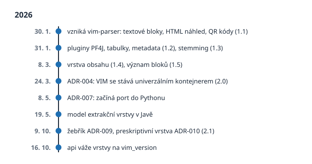

# Od 1.0 k 2.1

> Český překlad [02-from-1-0-to-2-1.md](02-from-1-0-to-2-1.md). Anglická verze je autoritativní.

## Dva dny v lednu

Většina formátů se rodí pomalu, ve výborech, přes návrhy a připomínky. VIM se narodil ve
spěchu. V pátek 30. ledna 2026 se v repozitáři pluginů Portunixu objevil nový plugin. Jeho
první commit se jmenoval *Initial plugin scaffold with VIM architecture*. Do večera téhož dne
uměl plugin rozřezat text PDF na bloky s přesnou polohou, ukázat výsledek jako HTML stránku
a najít na stránce dvourozměrné čárové kódy. Formát měl první dvě verze: **1.0** s fyzickou
a strukturální vrstvou a **1.1** s čárovými kódy.

Další den, sobota, byl ještě rušnější. Plugin se rozdělil do modulů a dostal vlastní systém
pluginů postavený na javové knihovně PF4J, aby každý druh vytěžování mohl žít ve vlastním
balíčku a dal se přidat nebo odebrat bez nového sestavení jádra. Orchestrátor se naučil
spouštět pluginy sám ve správném pořadí. Přibyly tabulky, pak metadata dokumentu a plný text
(**1.2**), pak obrázky a večer lemmatizátor, který převádí slova na kmeny pro vyhledávání
(**1.3**). Téhož dne proběhl pokus z prologu: otázka *kdo je zákazník* položená prostému
textu a souboru `vim.json`. Vrstvený model prošel první zkouškou, když mu byl sotva den.

## Dlouhý ocas skutečných dokumentů

Po prvním spěchu přišla pomalá práce, kterou zná každý nástroj na dokumenty: skutečné
dokumenty. Začátkem února dostal lemmatizátor nativní backendy pro češtinu, napsané v C++ a
připojené přes JNI, protože čeština je jazyk s bohatým tvaroslovím a jednoduchý stemmer jí
nestačí. Detekce tabulek se přestěhovala do vlastního univerzálního pluginu, aby ji mohly
využít i jiné nástroje.

Na konci února odhalil článek o umělé inteligenci typografický detail: **iniciálu**, velké
první písmeno odstavce. Pro stroj, který seskupuje znaky podle polohy, je iniciála osamělé
obří písmeno, které nepatří do žádného řádku. Parser se ji naučil rozpoznat a připojit zpět
ke slovu, které začíná, a textový prvek dostal pole `drop_cap_merged` a `drop_cap_bbox`. Tak
VIM obvykle roste: ne velkými plány, ale jedním tvrdohlavým dokumentem po druhém. Friedrich
Nietzsche znal takový pokrok dávno před softwarem:

> Největší události – to nejsou ty nejhlučnější, ale naše nejtišší chvíle. Svět se
> neotáčí kolem vynálezců nových hluků, ale kolem tvůrců nových hodnot; otáčí se neslyšně.

Iniciála připojená zpět ke svému slovu nedělá žádný hluk. Je jednou z těch nejtišších
chvil.

V březnu se parser potkal s knihami. Skript stáhl ukázkové knihy, mezi nimi *Hovory k sobě*
Marka Aurelia, a tým naučil parser číst obsah knihy, jak ten vytištěný, tak ten odvozený z
nadpisů. Dne 8. března se z toho stala vrstva `toc` a verze **1.4**. Téhož dne dostaly
bloky **důležitost**, primární nebo pomocnou, aby číslo stránky nebo živé záhlaví už
nevypadaly stejně důležitě jako text, a výchozí verzí se stala **1.5**.

Volba právě této knihy má v sobě tichou souhru. Před téměř dvěma tisíci lety si do týchž
stránek císař zapsal krátkou poznámku pro sebe:

> Dívej se dovnitř. Ať ti neunikne ani zvláštní povaha žádné věci, ani její hodnota.

Parser, který se učí číst obsah knihy, dělá malý kousek té práce. Dívá se pod povrch
stránky a snaží se nepřehlédnout, čím každá věc je, ani jakou má hodnotu.

Malá zvláštnost z té doby je vidět dodnes. V řadě 1.x nastavuje parser `vim_version` podle
funkcí, které dokument skutečně používá. Dokument s obsahem říká `"1.4"`, přestože parser
zná verzi 1.5. V letech 1.x byla `vim_version` blíž seznamu funkcí než verzi kontraktu.
Verze 2 to změnila.

## Kontejner pro všechny

Dne 24. března 2026 změnilo jedno architektonické rozhodnutí roli VIM. Jeho název byl
krátký: *VIM as Universal Result Container*.

Příčinou byl nový výrobce. Ekosystém Portunix dostával framework pro rozpoznávání
formulářů, `portunix-reco`, napsaný v Pythonu. Čte naskenované obrázky, ne PDF. Jeden
logický dokument může pocházet z mnoha obrázků. Vytěžuje pole z předem daných zón
formuláře a tabulka se může táhnout přes několik stránek a musí se spojit v jednu. VIM 1.5
nic z toho neuměl: jeho fyzická vrstva předpokládala text z PDF s písmy a sémantická vrstva
znala pevnou sadu typů entit.

Rozhodnutí zachovalo vše, co existovalo, a přidalo, co chybělo. Čtyři existující vrstvy
zůstaly beze změny; dokument 1.5 zůstal platným dokumentem 2.0. Nová vrstva `extraction`
přijala výsledky zpracování formulářů: odkaz na šablonu, která vytěžování řídila, surové
výsledky každého zdroje s úplným původem a sloučený logický dokument. Všechny vrstvy se
staly volitelnými. Parametry každého kroku vytěžování se uchovávají, aby ladicí nástroj
mohl vzít `vim.json`, najít zdrojový obrázek a krok zopakovat se stejným nastavením. A
každá změna hodnoty po vytěžení, ať od operátora, pravidla nebo jazykového modelu, se
zapisuje jako **revize**, zatímco původní surová hodnota se nikdy nemění.

Rozhodnutí končilo větou, na které tomuto repozitáři záleží: schémata nového formátu patří
do `api/contract/schemas/`, jako jazykově nezávislé kontrakty v JSON Schema.

## Dva jazyky, jeden model

V květnu měl parser zhruba 20 000 řádků Javy ve třinácti modulech Mavenu a pythonový svět
reco potřeboval stejnou logiku nativně. Volat Javu z každého pythonového nasazení znamenalo
JVM vedle každého workeru a startovací režii u každého dokumentu. Přepsat 20 000 řádků ručně
nebylo pro jednoho architekta reálné.

Rozhodnutí přijaté 8. května 2026 zvolilo třetí cestu: překladový nástroj. Nový modul
projektu Dream, `dream-java2py`, čte zdrojový kód Javy skutečným parserem jazyka Java,
mapuje knihovny (PDFBox, ZXing, Lucene) na jejich pythonové protějšky a nechává jazykový
model psát idiomatický Python, soubor po souboru, přičemž každý soubor projde rukama
člověka, než přistane v podbalíčku `ptx_reco.vim`. Port roste postupně a nástroj vede
záznam o tom, co je přeloženo a co ještě čeká.

Stejný měsíc přinesl ještě dvě věci. Dne 15. května vznikla samostatná **výzkumná
laboratoř** parseru, kde se problémy vytěžování sbírají jako dlouhodobé položky katalogu a
měří ve verzovaných výzvách. A 19. května vznikl javový model vrstvy `extraction`; další den
vyšel parser ve verzi 0.1.8.

## Žebřík a nová vrstva

Nové druhy informací stále přicházely a tým si všiml, že o každém se rozhodovalo zvlášť:
čárové kódy se staly kolekcí ve fyzické vrstvě, obsah knihy samostatnou vrstvou. Dne
9. října 2026 proměnilo nové architektonické rozhodnutí tyto zvyklosti v pravidlo: **rozhodovací žebřík**. Nová
informace se nejdřív zkusí stát volitelným polem existujícího prvku, pak kolekcí v
existující vrstvě a teprve jako poslední krok novou vrstvou, přes tři brány a čtyři
kritéria. Jedna z dalších kapitol žebřík podrobně prochází.

Téhož dne jím prošel první kandidát. Druhé rozhodnutí přidalo vrstvu `prescriptive` a verzi
**2.1**. Drží to, co dokument *předepisuje*: požadavky, doporučení a svolení specifikace,
odkazy na jiné dokumenty a pojmy, které definuje. Jazykový model ustanovení navrhne, člověk
je potvrdí nebo zamítne a každé ustanovení ukazuje na stránku a blok, ze kterého pochází.

Téhož dne dorazila schémata nové vrstvy do tohoto repozitáře. Během dalších dvou dnů dostal
model preskriptivní vrstvy javový parser i pythonový port a javový model extrakční vrstvy se
srovnal s kontraktem, vadu po vadě. Dne 16. října zpřísnil kontrakt vazbu mezi vrstvami a
verzemi: dokument s vrstvou `prescriptive` musí říkat `"2.1"`, dokument s vrstvou
`extraction` musí říkat `"2.0"` nebo `"2.1"`. `vim_version` řady 2.x je slib, už ne seznam
funkcí.

## Verze v kostce

| Verze | Co přidala | Poprvé |
| ----- | ---------- | ------ |
| 1.0 | Textové bloky: fyzická a strukturální vrstva | 30. ledna 2026 |
| 1.1 | Čárové kódy | 30. ledna 2026 |
| 1.2 | Metadata dokumentu a plný text | 31. ledna 2026 |
| 1.3 | Stemming | 31. ledna 2026 |
| 1.4 | Vrstva obsahu | 8. března 2026 |
| 1.5 | Grafika, tabulky a grafické prvky; výchozí verze parseru | 8. března 2026 |
| 2.0 | Vrstva `extraction`, všechny vrstvy volitelné, zdroje, revize | specifikována 24. března 2026 |
| 2.1 | Vrstva `prescriptive`, pole `property` u revizí | specifikována 9. října 2026 |

Prvním commitem a verzí 2.1 dělí devět měsíců. Za tu dobu se VIM změnil z pluginu, který
čte faktury, v model sdílený javovým parserem, pythonovým portem, frameworkem pro
rozpoznávání formulářů, pipeline pro vytěžování faktur a kontraktem v tomto repozitáři.

Roku 1975 vydal americký lékař a spisovatel John Gall malou, ironickou knihu o tom, jak se
chovají systémy, *Systemantics*. Jedna z jejích vět přežila všechny ostatní a dnes se jí
říká Gallův zákon:

> Složitý systém, který funguje, se vždy vyvinul z jednoduchého systému, který fungoval.

VIM je malým příkladem tohoto zákona. Nezačal jako univerzální kontejner se šesti vrstvami.
Začal jako plugin, který uměl rozřezat text faktury na bloky, a fungoval hned první den.
Všechno ostatní vyrostlo na něčem, co už fungovalo.

Další kapitola otevírá skutečný `vim.json` a dívá se, co je uvnitř.

## Prameny

- Historie commitů `plugins/vim-parser` v `portunix-plugins` (30. ledna až 11. října 2026)
- ADR-004 *VIM as Universal Result Container* (24. března 2026), ADR-007 *Port vim-parser
  to Python via Dream Translation Tool* (8. května 2026), ADR-009 *Criteria for Adding a
  New VIM Layer* a ADR-010 *VIM Prescriptive Layer* (9. října 2026), `portunix-architecture`
- [CHANGELOG.md](../../../../CHANGELOG.md) tohoto repozitáře: preskriptivní vrstva VIM
  (#42) a vazba vrstev na `vim_version` (#51)
- Friedrich Nietzsche, *Tak pravil Zarathustra*, část II, *O velkých událostech*; český
  překlad citován podle knihy Lukáš Sedláček, *Nazí v AI době* (2025), strana 19; anglicky
  v překladu Thomase Commona: [Project Gutenberg](https://www.gutenberg.org/ebooks/1998)
- John Gall, *General Systemantics* (1975), znovu vydáno jako *Systemantics* (1977); český
  překlad citátu je vlastní:
  [John Gall (author)](https://en.wikipedia.org/wiki/John_Gall_(author))
- Marcus Aurelius, *Hovory k sobě*, kniha VI, oddíl 3; český překlad citátu je vlastní,
  podle anglického překladu George Longa:
  [Thoughts of Marcus Aurelius Antoninus](https://www.gutenberg.org/ebooks/15877)
  (Project Gutenberg)
- Historie commitů `src/ptx_reco/vim` v `portunix-reco` a repozitáře
  `portunix-vim-parser-research-lab`
