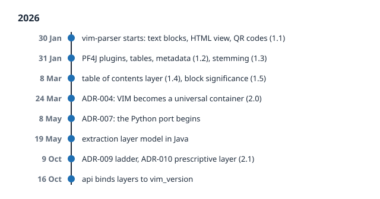

# From 1.0 to 2.1

## Two Days in January

Most formats are born slowly, in committees, over drafts and comments. VIM was born in a
rush. On Friday, 30 January 2026, a new plugin appeared in the repository of the Portunix
plugins. Its first commit was called *Initial plugin scaffold with VIM architecture*. By
the evening of the same day, the plugin could cut the text of a PDF into blocks with exact
positions, show the result as an HTML page, and find two-dimensional barcodes on the page.
The format had its first two versions: **1.0** with the physical and structural layers, and
**1.1** with barcodes.

The next day, Saturday, was even busier. The plugin was split into modules and got a
system of plugins of its own, built on the Java library PF4J, so that each kind of
extraction could live in its own package and be added or removed without rebuilding the
core. An orchestrator learned to run the plugins in the right order by itself. Tables
arrived, then document metadata and the full text (**1.2**), then images, and in the
evening a lemmatizer that reduces words to their stems for search (**1.3**). On the same
day, the experiment from the prologue was run: the question *who is the customer* asked of
plain text and of a `vim.json`. The layered model passed its first test while it was
barely one day old.

## The Long Tail of Real Documents

After the first rush came the slow work that every document tool knows: real documents.
In early February the lemmatizer got native backends for Czech, written in C++ and
connected through JNI, because Czech is a language with rich word forms and a simple
stemmer does not do it justice. Table detection moved into its own universal plugin, so
that other tools could use it too.

At the end of February, an article about artificial intelligence exposed a typographic
detail: a **drop cap**, the large first letter of a paragraph. To a machine that groups
characters by position, a drop cap is a lonely giant letter that belongs to no line. The
parser learned to detect it and merge it back into the word it starts, and the text element
got the fields `drop_cap_merged` and `drop_cap_bbox`. This is how VIM usually grows: not by
grand plans, but by one stubborn document at a time. Friedrich Nietzsche knew this kind of
progress long before software:

> The greatest events—are not our noisiest, but our stillest hours. Not around the
> inventors of new noise, but around the inventors of new values, doth the world revolve;
> inaudibly it revolveth.

A drop cap merged back into its word makes no noise. It is one of the still hours.

In March, the parser met books. A script downloaded sample books, among them the
*Meditations* of Marcus Aurelius, and the team taught the parser to read a table of
contents, both the explicit one printed in the book and one inferred from the headings. On
8 March this became the `toc` layer and version **1.4**. On the same day, blocks got a
**significance**, primary or auxiliary, so that a page number or a running header no longer
looks as important as the text, and the default version became **1.5**.

There is a quiet fitness in the choice of that book. Almost two thousand years ago, the
emperor wrote into the same pages a short note to himself:

> Look within. Let neither the peculiar quality of anything nor its value escape thee.

A parser that learns to read a table of contents does a small part of that work. It looks
beneath the surface of the page, and it tries to miss neither what each thing is nor what
it is worth.

A small quirk from this time is still visible today. In the 1.x line, the parser sets
`vim_version` by the features a document actually uses. A document with a table of
contents says `"1.4"`, even though the parser knows version 1.5. In the 1.x years,
`vim_version` was closer to a list of features than to a version of a contract. Version 2
changed that.

## A Container for Everyone

On 24 March 2026, an architecture decision changed the role of VIM. Its title was short:
*VIM as Universal Result Container*.

The cause was a new producer. The Portunix ecosystem was getting a framework for form
recognition, `portunix-reco`, written in Python. It reads scanned images, not PDFs. One
logical document may come from many images. It extracts fields from predefined zones of a
form, and a table may run over several pages and has to be merged into one. VIM 1.5 could
not hold any of that: its physical layer assumed PDF text with fonts, and its semantic
layer knew a fixed set of entity types.

The decision kept everything that existed and added what was missing. The four existing
layers stayed unchanged; a 1.5 document stayed a valid 2.0 document. A new layer,
`extraction`, received the results of form processing: a reference to the template that
drove the extraction, the raw results of each source with full provenance, and the merged
logical document. Every layer became optional. The parameters of every extraction step
were kept, so that a debugging tool can take a `vim.json`, find the source image and run
the step again with identical settings. And every change of a value after extraction, by
an operator, a rule or a language model, is recorded as a **revision**, while the original
raw value never changes.

The decision ended with a sentence that matters for this repository: the schemas of the
new format go to `api/contract/schemas/`, as language-independent JSON Schema contracts.

## Two Languages, One Model

By May, the parser had about 20,000 lines of Java in thirteen Maven modules, and the
Python world of reco needed the same logic natively. Calling Java from every Python
deployment meant a JVM next to every worker and a start-up cost for every document.
Rewriting 20,000 lines by hand was not realistic for one architect.

A decision accepted on 8 May 2026 chose a third way: a translation tool. A new module of
the Dream project, `dream-java2py`, reads the Java source with a real parser of the Java
language, maps the libraries (PDFBox, ZXing, Lucene) to their Python counterparts, and lets
a language model write idiomatic Python, file by file, with a person reviewing every file
before it lands in the sub-package `ptx_reco.vim`. The port grows incrementally, and the
tool keeps a record of what is translated and what is still waiting.

The same month brought two more things. On 15 May, a separate **research lab** for the
parser was founded, where extraction problems are collected as long-lived catalog entries
and measured in versioned challenges. And on 19 May, the Java model of the `extraction`
layer was written; the next day the parser was released as version 0.1.8.

## A Ladder and a New Layer

New kinds of information kept arriving, and the team noticed that each one had been
decided alone: barcodes became a collection in the physical layer, the table of contents
became a layer of its own. On 9 October 2026, a new architecture decision turned these habits into a rule: a
**decision ladder**. New information first tries to be an optional field on an existing
element, then a collection in an existing layer, and only as a last step a new layer, with
three gates and four criteria to pass. A later chapter walks through the ladder in detail.

On the same day, the first candidate passed it. A second decision added the `prescriptive` layer and
version **2.1**. It holds what a document *prescribes*: the requirements, recommendations
and permissions of a specification, the references to other documents and the terms it
defines. A language model proposes the provisions, a person confirms or rejects them, and
every provision points to the page and the block it came from.

The same day, the schemas of the new layer arrived in this repository. Over the next two
days, the Java parser and the Python port both got the model of the prescriptive layer,
and the Java model of the extraction layer was aligned with the contract, defect by
defect. On 16 October, the contract made the link between layers and versions strict: a
document with the `prescriptive` layer must say `"2.1"`, a document with the `extraction`
layer must say `"2.0"` or `"2.1"`. The `vim_version` of 2.x is a promise, no longer a list
of features.

## Versions at a Glance

| Version | What it added | First seen |
| ------- | ------------- | ---------- |
| 1.0 | Text blocks: physical and structural layers | 30 January 2026 |
| 1.1 | Barcodes | 30 January 2026 |
| 1.2 | Document metadata and full text | 31 January 2026 |
| 1.3 | Stemming | 31 January 2026 |
| 1.4 | Table of contents layer | 8 March 2026 |
| 1.5 | Graphics, tables and graphic elements; the default version of the parser | 8 March 2026 |
| 2.0 | `extraction` layer, all layers optional, sources, revisions | specified 24 March 2026 |
| 2.1 | `prescriptive` layer, `property` on revisions | specified 9 October 2026 |

Nine months separate the first commit from version 2.1. In that time VIM went from a
plugin that reads invoices to a model shared by a Java parser, a Python port, a form
recognition framework, an invoice extraction pipeline and the contract in this repository.

In 1975, the American physician and writer John Gall published a small, ironic book about
how systems behave, *Systemantics*. One of its sentences outlived the rest and is known
today as Gall's law:

> A complex system that works is invariably found to have evolved from a simple system
> that worked.

VIM is a small example of that law. It did not start as a universal container with six
layers. It started as a plugin that could cut the text of an invoice into blocks, and it
worked on its first day. Everything else grew on top of something that already worked.

The next chapter opens a real `vim.json` and looks at what is inside.

## Sources

- Commit history of `plugins/vim-parser` in `portunix-plugins` (30 January to 11 October
  2026)
- ADR-004 *VIM as Universal Result Container* (24 March 2026), ADR-007 *Port vim-parser to
  Python via Dream Translation Tool* (8 May 2026), ADR-009 *Criteria for Adding a New VIM
  Layer* and ADR-010 *VIM Prescriptive Layer* (9 October 2026), `portunix-architecture`
- [CHANGELOG.md](../../../../CHANGELOG.md) of this repository: VIM prescriptive layer
  (#42) and the binding of layers to `vim_version` (#51)
- Friedrich Nietzsche, *Thus Spake Zarathustra*, part II, *Great Events*, translated by
  Thomas Common: [Project Gutenberg](https://www.gutenberg.org/ebooks/1998)
- John Gall, *General Systemantics* (1975), republished as *Systemantics* (1977):
  [John Gall (author)](https://en.wikipedia.org/wiki/John_Gall_(author))
- Marcus Aurelius, *Meditations*, book VI, section 3, translated by George Long:
  [Thoughts of Marcus Aurelius Antoninus](https://www.gutenberg.org/ebooks/15877)
  (Project Gutenberg)
- Commit history of `src/ptx_reco/vim` in `portunix-reco` and of
  `portunix-vim-parser-research-lab`
