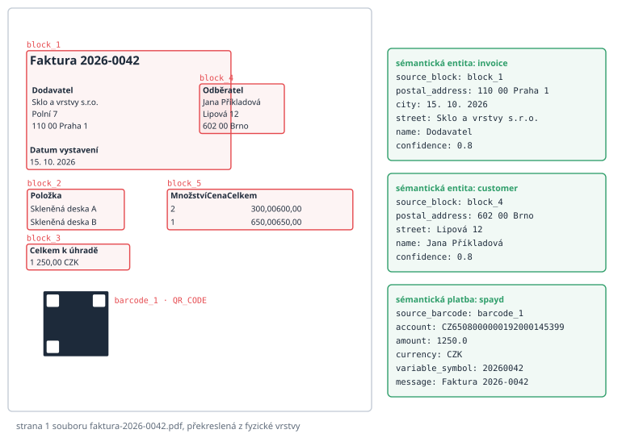
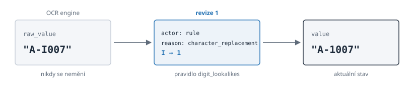

# Uvnitř vim.json

> Český překlad [03-inside-a-vim-json.md](03-inside-a-vim-json.md). Anglická verze je autoritativní.

## Malá faktura

Abychom mohli nahlédnout dovnitř VIM, potřebujeme dokument. Pro tuto knihu jsme jeden
vyrobili: jednostránkovou fakturu vymyšlené sklářské firmy *Sklo a vrstvy s.r.o.*
vymyšlené odběratelce v Brně. Má nadpis, dva adresní bloky vedle sebe, datum vystavení,
malou tabulku se dvěma položkami, celkovou částku a QR kód pro platbu ve formátu SPAYD.
Každé jméno a každé číslo je smyšlené, takže faktura smí být otištěna ve veřejné knize.

PDF jsme předali skutečnému parseru, verzi 0.1.8, s výchozím nastavením:

```bash
java -jar vim-parser-0.1.8-SNAPSHOT.jar auto -o faktura-2026-0042.pdf.vim.json faktura-2026-0042.pdf
```

Výsledkem je soubor JSON o zhruba 31 kilobajtech. Všechno v této kapitole je z něj
okopírované, jen dlouhá pole jsou zkrácena. PDF, `vim.json` i skript, který fakturu vyrobil,
leží vedle knihy, takže si běh můžete zopakovat. Anglické vydání knihy používá tutéž fakturu
v angličtině a parser se nad oběma rozhoduje stejně.

## Obálka

Každý dokument VIM má nahoře stejné tři části:

```json
{
  "vim_version" : "1.4",
  "document" : {
    "source" : "faktura-2026-0042.pdf",
    "pages" : 1,
    "metadata" : {
      "encodingFormat" : "application/pdf",
      "contentSize" : 11122,
      "inLanguage" : "cs",
      "producer" : "WeasyPrint 70.0"
    }
  },
  "layers" : { "physical" : { }, "structural" : { }, "semantic" : { }, "toc" : { } }
}
```

`vim_version` říká `"1.4"`, protože dokument má vrstvu obsahu; předchozí kapitola tento zvyk
řady 1.x vysvětlila. `document` popisuje zdroj: název souboru, počet stran a metadata se
jmény převzatými ze slovníku Schema.org (`encodingFormat`, `inLanguage`). Jazyk parser
rozpoznal jako češtinu sám. A `layers` nese skleněné tabule.

## Fyzická vrstva: co tam je

Fyzická vrstva naší faktury má pět textových bloků, jeden čárový kód, jednu tabulku, jeden
grafický prvek a plný text. Blok je skupina textových prvků, které stojí blízko sebe. Takto
začíná blok s odběratelem:

```json
{
  "id" : "block_4",
  "bbox" : { "x" : 299.1, "y" : 155.7, "width" : 84.4, "height" : 44.8 },
  "page" : 1,
  "text_elements" : [ {
    "text" : "Odběratel",
    "font_size" : 14.0,
    "font_name" : "UWGIWA+DejaVu-Sans-Bold",
    "confidence" : 1.0
  }, {
    "text" : "Jana Příkladová",
    "font_name" : "XKQQSR+DejaVu-Sans"
  } ]
}
```

Každý prvek zná svůj obdélník na stránce (`bbox`, v bodech PDF), svou stránku a své písmo.
Název písma končí u popisku na *Bold* a u jména ne; právě tento drobný detail parseru později
umožní popisky najít. Spolehlivost je 1,0, protože text převzatý přímo z PDF se nehádá.
Textový prvek přečtený OCR ze skenu by nesl nižší číslo.

Čárový kód je uložen přesně tak, jak byl dekódován, i se svou polohou:

```json
{
  "id" : "barcode_1",
  "page" : 1,
  "format" : "QR_CODE",
  "raw_content" : "SPD*1.0*ACC:CZ6508000000192000145399*AM:1250.00*CC:CZK*X-VS:20260042*MSG:Faktura 2026-0042"
}
```

Tady pracuje princip obousměrnosti. Fyzická vrstva obsahuje dost na to, aby se stránka dala
znovu nakreslit. Následující obrázek nakreslil skript jen z `vim.json`: každé slovo stojí
tam, kde ho parser viděl, každý červený rámeček je fyzický blok a zelené rámečky vpravo
ukazují, co z nich udělala sémantická vrstva.



## Strukturální vrstva: jak to vypadá

Strukturální vrstva dává každému fyzickému bloku tvar. ID zůstávají stejná:

```json
{
  "id" : "block_4",
  "type" : "labeled_content",
  "significance" : "primary",
  "page" : 1,
  "header" : "Odběratel",
  "content" : [ "Jana Příkladová", "Lipová 12", "602 00 Brno" ]
}
```

Tučný první řádek se stal záhlavím (`header`), zbytek obsahem (`content`). Přesně tuto
strukturu jazykový model v prologu v prostém textu postrádal. Strukturální záznam dostane i
čárový kód: typ obsahu (`spayd`) a seznam bloků ve svém okolí, aby čtenář našel text, který
kód vysvětluje.

## Sémantická vrstva: co to znamená

Na sémantické vrstvě mění parser bloky v entity a kódy v platby:

```json
"entities" : [ {
  "type" : "customer",
  "source_block" : "block_4",
  "fields" : { "name" : "Jana Příkladová", "street" : "Lipová 12", "postal_address" : "602 00 Brno" },
  "confidence" : 0.8
} ],
"payments" : [ {
  "type" : "payment",
  "source_barcode" : "barcode_1",
  "format" : "spayd",
  "fields" : { "account" : "CZ6508000000192000145399", "amount" : 1250.0,
               "currency" : "CZK", "variable_symbol" : "20260042", "message" : "Faktura 2026-0042" },
  "confidence" : 1.0
} ]
```

Stojí za to všimnout si dvou věcí. Zaprvé každý sémantický výsledek ukazuje na svůj zdroj:
`source_block` nebo `source_barcode`. Zadruhé se spolehlivosti liší. Zákazník byl nalezen
porovnáním popisku *Odběratel* se známými záhlavími, což je heuristika, a tak dostal 0,8.
Platba byla dekódována ze standardního formátu se všemi povinnými poli, a tak dostala 1,0.

## Kde se parser spletl

Poctivá kniha musí ukázat i druhou stranu mince. Tentýž soubor obsahuje tři chyby a každá
otevírá nový obzor.

**Nadpis spolkl dodavatele.** Blok `block_1` obsahuje nadpis *Faktura 2026-0042*, adresu
dodavatele i datum vystavení, protože stojí v jednom sloupci blízko sebe. Strukturální
vrstva proto vzala nadpis jako záhlaví celého bloku a sémantická vrstva vytvořila entitu
typu `invoice`, jejíž `name` je *Dodavatel* a jejíž `city` je *15. 10. 2026*. Spolehlivost
je přesto 0,8: heuristika neví, že se nechala napálit.

**Sloupce tabulky se slily.** Ve fyzickém bloku tabulky se buňky *300,00* a *600,00* staly
jedním řetězcem `300,00600,00`, protože parser spojil znaky na jednom řádku bez mezery mezi
sloupci. Detektor tabulek, který pracuje samostatně, našel mřížku o dvanácti řádcích a
čtyřech sloupcích přes velkou část stránky, s buňkami jako *Faktura 202* a *6-004*. Plný
text z extraktoru metadat má naopak řádky tabulky správně: *Skleněná deska A 2 300,00
600,00*.

**Obsah našel nadpisy ve faktuře.** Vrstva `toc` uvádí jako položky nadpis a tři záhlaví
bloků se zdrojem `heuristic`. U faktury je to šum; u knihy by to bylo užitečné.

Nic z toho není skryté. Každá chybná hodnota nese ID bloku, ze kterého pochází, metodu a
spolehlivost a spotřebitel ji může prověřit. Vícesloupcová sazba a tabulky jsou přesně ty
problémy, které výzkumná laboratoř parseru vede jako položky katalogu, jak ukáže poslední
kapitola.

## Extrakční vrstva: co nese formulář

Naše faktura extrakční vrstvu nemá; parser ji nevyrábí. Kontrakt v tomto repozitáři má ale
její malý příklad, `form-extraction.vim.json`: jeden naskenovaný formulář, jedno pole.
Myšlenku revizí ukazuje lépe než jakýkoli popis:

```json
{
  "field_id" : "order_number",
  "label" : "Order number",
  "value" : "A-1007",
  "raw_value" : "A-I007",
  "data_type" : "string",
  "confidence" : 0.71,
  "revisions" : [ {
    "revision" : 1,
    "old_value" : "A-I007",
    "new_value" : "A-1007",
    "actor" : "rule",
    "actor_id" : "rule:digit_lookalikes",
    "reason" : "character_replacement"
  } ]
}
```

OCR engine přečetl velké *I* tam, kde má formulář číslici *1*. Pravidlo, které zná podobně
vypadající znaky, to opravilo. `raw_value` uchovává, co engine skutečně přečetl, a nikdy se
nemění; `value` ukazuje aktuální stav; revize říká, kdo hodnotu změnil a proč. Pokud ji
později opraví operátor, přibude druhá revize.



Kolem polí drží vrstva odkaz na šablonu, která definovala zóny (`template_ref`), jeden
záznam pro každý zdroj s jeho původem (`sources`) a sloučený logický dokument (`document`),
kde se scházejí pole z mnoha stránek i tabulky rozdělené přes stránky.

## Preskriptivní vrstva: co předepisuje

Druhý příklad kontraktu, `definition-file.vim.json`, ukazuje nejmladší vrstvu. Jeho zdrojem
je dvanáctistránkový dokument s pravidly pro rohová razítka technických výkresů. Jedno z
jeho ustanovení:

```json
{
  "provision_id" : "p-5.3.2-1",
  "kind" : "requirement",
  "clause" : "5.3.2",
  "text" : "The title block shall contain the drawing number.",
  "anchors" : [ { "page" : 7, "element_type" : "block", "element_id" : "block_41" } ],
  "relations" : [ { "provision_id" : "p-5.3.1-1", "relation" : "refines" } ],
  "verification" : { "method" : "automatic", "subject" : "drawing",
                     "rule" : { "field" : "drawing_number", "check" : "present" } },
  "status" : "confirmed",
  "confidence" : 0.82
}
```

Ustanovení je požadavek, doporučení nebo svolení. Má stabilní ID, číslo článku, doslovný
text a kotvu do fyzické vrstvy téhož dokumentu: strana 7, blok 41. Může zpřesňovat jiné
ustanovení, záviset na něm, být z něj výjimkou nebo s ním být v rozporu. Říká, jak se dá
ověřit: automaticky, testem nebo člověkem. A má stav. Jazykový model navrhuje ustanovení jako
`proposed`; teprve člověk je udělá `confirmed`. V příkladu historie revizí ukazuje, že
recenzent změnil druh tohoto ustanovení z *doporučení* na *požadavek* s komentářem *The
verbal form is shall*.

## Šest vrstev v jedné tabulce

| Vrstva | Hlavní obsah | Typický výrobce |
| ------ | ------------ | --------------- |
| `physical` | `blocks` s textovými prvky, `barcodes`, `tables`, `graphics`, `fulltext` | vim-parser |
| `structural` | `blocks` se záhlavím, obsahem, typem a důležitostí; `barcodes` s bloky v okolí | vim-parser |
| `semantic` | `entities`, `payments`, `stemming` | vim-parser |
| `toc` | `entries` s nadpisem, stránkou, úrovní, blokem a zdrojem | vim-parser |
| `extraction` | `template_ref`, `sources`, `document`; pole s `revisions` | reco a další |
| `prescriptive` | `definition`, `provisions`, `references`, `terms` | výrobce s jazykovým modelem, kontrolovaný člověkem |

Další kapitola se dívá na stroj, který píše první čtyři vrstvy: jak PDF projde pluginy
parseru a vyjde z něj `vim.json`.
