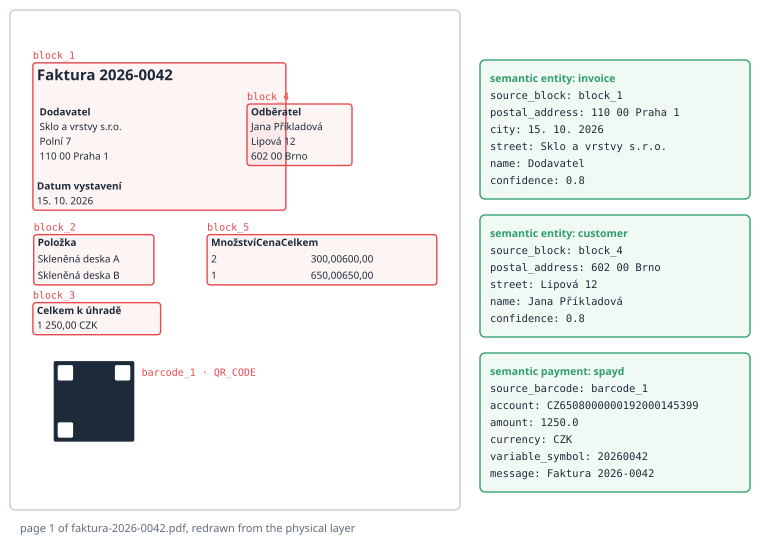
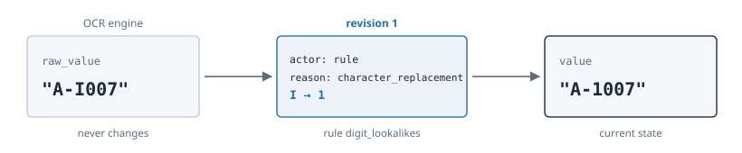

# Inside a vim.json

## A Small Invoice

To look inside VIM, we need a document. For this book we made one: a one-page invoice
from an invented glass company, *Glass & Layers Ltd.* in Prague, to an invented customer
in Brno. It has a title, two address blocks side by side, an issue date,
a small table with two items, a total and a QR code for payment in the Czech SPAYD format.
Every name and number in it is made up, so it can be printed in a public book.

We gave the PDF to the real parser, version 0.1.8, with its default settings:

```bash
java -jar vim-parser-0.1.8-SNAPSHOT.jar auto -o invoice-2026-0042.pdf.vim.json invoice-2026-0042.pdf
```

The result is a JSON file of about 31 kilobytes. Everything in this chapter is copied from
it; only long arrays are shortened. The PDF, the `vim.json` and the script that made the
invoice are stored next to the book, so you can repeat the run. The Czech edition of the
book uses the same invoice in Czech, and the parser makes the same decisions on both.

## The Envelope

Every VIM document has the same three parts at the top:

```json
{
  "vim_version" : "1.4",
  "document" : {
    "source" : "invoice-2026-0042.pdf",
    "pages" : 1,
    "metadata" : {
      "encodingFormat" : "application/pdf",
      "contentSize" : 11205,
      "inLanguage" : "en",
      "producer" : "WeasyPrint 70.0"
    }
  },
  "layers" : { "physical" : { }, "structural" : { }, "semantic" : { }, "toc" : { } }
}
```

`vim_version` says `"1.4"` because the document has a table of contents layer; the
previous chapter explained this habit of the 1.x line. `document` describes the source:
its file name, its page count and metadata with names taken from the Schema.org
vocabulary (`encodingFormat`, `inLanguage`). The parser detected the language as English
by itself. And `layers` holds the sheets of glass.

## The Physical Layer: What Is There

The physical layer of our invoice has five text blocks, one barcode, one table, one
graphic element and the full text. A block is a group of text elements that stand close
together. Here is the start of the block with the customer:

```json
{
  "id" : "block_4",
  "bbox" : { "x" : 299.1, "y" : 155.7, "width" : 84.4, "height" : 44.8 },
  "page" : 1,
  "text_elements" : [ {
    "text" : "Customer",
    "font_size" : 14.0,
    "font_name" : "UWGIWA+DejaVu-Sans-Bold",
    "confidence" : 1.0
  }, {
    "text" : "Jane Sample",
    "font_name" : "XKQQSR+DejaVu-Sans"
  } ]
}
```

Every element knows its rectangle on the page (`bbox`, in PDF points), its page and its
font. The font name ends with *Bold* for the label and not for the name; that small detail
is what lets the parser find labels later. The confidence is 1.0, because text taken
directly from a PDF is not guessed. A text element read by OCR from a scan would carry a
lower number.

The barcode is kept exactly as it was decoded, with its position:

```json
{
  "id" : "barcode_1",
  "page" : 1,
  "format" : "QR_CODE",
  "raw_content" : "SPD*1.0*ACC:CZ6508000000192000145399*AM:1250.00*CC:CZK*X-VS:20260042*MSG:Invoice 2026-0042"
}
```

This is the principle of bidirectionality at work. The physical layer holds enough to draw
the page again. The next figure was drawn by a script from nothing but the `vim.json`:
every word stands where the parser saw it, every red frame is a physical block, and the
green boxes on the right show what the semantic layer made of them.



## The Structural Layer: What It Looks Like

The structural layer gives each physical block a shape. It keeps the same IDs:

```json
{
  "id" : "block_4",
  "type" : "labeled_content",
  "significance" : "primary",
  "page" : 1,
  "header" : "Customer",
  "content" : [ "Jane Sample", "12 Linden Street", "602 00 Brno" ]
}
```

The bold first line became the `header`, the rest became `content`. This is exactly the
structure that the language model in the prologue was missing in plain text. The barcode
also gets a structural record: its content type (`spayd`) and the list of blocks near it,
so that a reader can find the text that explains a code.

## The Semantic Layer: What It Means

On the semantic layer, the parser turns blocks into entities and codes into payments:

```json
"entities" : [ {
  "type" : "customer",
  "source_block" : "block_4",
  "fields" : { "name" : "Jane Sample", "street" : "12 Linden Street", "postal_address" : "602 00 Brno" },
  "confidence" : 0.8
} ],
"payments" : [ {
  "type" : "payment",
  "source_barcode" : "barcode_1",
  "format" : "spayd",
  "fields" : { "account" : "CZ6508000000192000145399", "amount" : 1250.0,
               "currency" : "CZK", "variable_symbol" : "20260042", "message" : "Invoice 2026-0042" },
  "confidence" : 1.0
} ]
```

Two things are worth noticing. First, every semantic result points to its source:
`source_block` or `source_barcode`. Second, the confidences differ. The customer was found
by matching the label *Customer* against known headers, which is a heuristic, so it gets
0.8. The payment was decoded from a standard format with all required fields present, so
it gets 1.0.

## What the Parser Got Wrong

An honest book has to show the other side of the coin too. The same file contains three
mistakes, and each of them opens a new direction.

**The title swallowed the supplier.** Block `block_1` contains the title *Invoice
2026-0042*, the supplier's address and the issue date, because they stand in one column
close to each other. The structural layer therefore took the title as the header of the
whole block, and the semantic layer produced an entity of type `invoice` whose `name` is
*Supplier* and whose `city` is *15 October 2026*. The confidence is still 0.8: the
heuristic does not know that it was fooled.

**The table columns melted.** In the physical block of the table, the cells *300.00* and
*600.00* became one string, `300.00600.00`, because the parser glued characters on one line
without a space between columns. The table detector, working separately, found a grid of
twelve rows and four columns over a large part of the page, with cells like *Invoice 20* and
*26-004*. The full text from the metadata extractor, on the other hand, has the table rows
right: *Glass panel A 2 300.00 600.00*.

**The table of contents found headings in an invoice.** The `toc` layer lists the title and
three block headers as entries, with the source `heuristic`. For an invoice this is noise;
for a book it would be useful.

None of this is hidden. Every wrong value carries the ID of the block it came from, the
method and a confidence, and a consumer can check it. Multi-column layout and tables are
exactly the problems that the research lab of the parser keeps as catalog entries, as the
last chapter shows.

## The Extraction Layer: What the Form Holds

Our invoice has no extraction layer; the parser does not produce it. The contract in this
repository has a small example of it, `form-extraction.vim.json`: one scanned form, one
field. It shows the idea of revisions better than any description:

```json
{
  "field_id" : "order_number",
  "label" : "Order number",
  "value" : "A-1007",
  "raw_value" : "A-I007",
  "data_type" : "string",
  "confidence" : 0.71,
  "revisions" : [ {
    "revision" : 1,
    "old_value" : "A-I007",
    "new_value" : "A-1007",
    "actor" : "rule",
    "actor_id" : "rule:digit_lookalikes",
    "reason" : "character_replacement"
  } ]
}
```

The OCR engine read a capital *I* where the form has the digit *1*. A rule that knows
lookalike characters corrected it. The `raw_value` keeps what the engine really read and
never changes; the `value` shows the current state; the revision says who changed it and
why. If an operator later corrects the value again, a second revision is added.



Around the fields, the layer holds a reference to the template that defined the zones
(`template_ref`), one entry per source with its provenance (`sources`), and the merged
logical document (`document`), where fields from many pages and tables split over pages
come together.

## The Prescriptive Layer: What It Requires

The second example of the contract, `definition-file.vim.json`, shows the youngest layer.
Its source is a twelve-page document with rules for the title blocks of technical
drawings. One of its provisions:

```json
{
  "provision_id" : "p-5.3.2-1",
  "kind" : "requirement",
  "clause" : "5.3.2",
  "text" : "The title block shall contain the drawing number.",
  "anchors" : [ { "page" : 7, "element_type" : "block", "element_id" : "block_41" } ],
  "relations" : [ { "provision_id" : "p-5.3.1-1", "relation" : "refines" } ],
  "verification" : { "method" : "automatic", "subject" : "drawing",
                     "rule" : { "field" : "drawing_number", "check" : "present" } },
  "status" : "confirmed",
  "confidence" : 0.82
}
```

A provision is a requirement, a recommendation or a permission. It has a stable ID, the
number of its clause, the verbatim text, and an anchor into the physical layer of the same
document: page 7, block 41. It can refine another provision, depend on it, be an exception
to it or conflict with it. It says how it can be checked: automatically, by a test or by a
person. And it has a status. A language model proposes provisions as `proposed`; only a
person makes them `confirmed`. In the example, the revision history shows that a reviewer
changed the kind of this provision from *recommendation* to *requirement*, with the
comment *The verbal form is shall*.

## Six Layers in One Table

| Layer | Main content | Typical producer |
| ----- | ------------ | ---------------- |
| `physical` | `blocks` with text elements, `barcodes`, `tables`, `graphics`, `fulltext` | vim-parser |
| `structural` | `blocks` with header, content, type and significance; `barcodes` with nearby blocks | vim-parser |
| `semantic` | `entities`, `payments`, `stemming` | vim-parser |
| `toc` | `entries` with title, page, level, block and source | vim-parser |
| `extraction` | `template_ref`, `sources`, `document`; fields with `revisions` | reco and others |
| `prescriptive` | `definition`, `provisions`, `references`, `terms` | LLM-based producer, reviewed by a person |

The next chapter looks at the machine that writes the first four layers: how a PDF travels
through the plugins of the parser and comes out as a `vim.json`.
