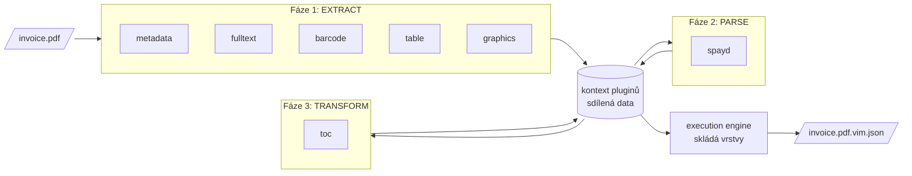

# Stroj, který čte

> Český překlad [04-the-machine-that-reads.md](04-the-machine-that-reads.md). Anglická verze je autoritativní.

## Dílna, ne jeden stroj

Dobrým obrazem `vim-parseru` není jeden velký stroj s jedním vstupem a jedním výstupem. Je to
dílna se specialisty. Jeden čte metadata souboru. Další rozřezává text na bloky. Další hledá
čárové kódy, další tabulky, další obrázky. Když specialista na čárové kódy skončí, přečte
specialista na platby kódy, které našel. Nakonec někdo složí z nadpisů obsah. Každý
specialista umí jednu práci a své výsledky nechává na společném stole pro ostatní.

V kódu jsou specialisté **pluginy** a společný stůl je **kontext pluginů**. Vedoucím dílny
je **orchestrátor**, který rozhoduje, kdo kdy pracuje.

## Pluginy v balíčcích

Parser je projekt v Javě 21 s více než tuctem modulů Mavenu. Jádrem je jediný „tlustý“ JAR
s příkazovou řádkou, orchestrátorem a běhovým prostředím pluginů. Každý plugin je samostatný
soubor ZIP v adresáři `plugins/` vedle něj. Běhovým prostředím pluginů je
[PF4J](https://pf4j.org/), malý framework pro pluginy v Javě: při startu najde soubory ZIP,
každý načte vlastním class loaderem a zeptá se ho, co umí.

Tento návrh přišel druhý den života parseru a nebyl náhodou. Plugin lze přidat, vyměnit
nebo odebrat bez nového sestavení jádra. Nativní backendy lemmatizátoru pro češtinu, psané v
C++, žijí ve vlastních pluginech; nasazení, které je nepotřebuje, prostě nemá jejich soubory
ZIP.

Pluginy jsou několika druhů, daných třemi body rozšíření v modulu API:

| Druh | Bod rozšíření | Práce | Pluginy |
| ---- | ------------- | ----- | ------- |
| Extraktor | `ExtractorPlugin` | Čte surová data ze souboru | metadata, fulltext, barcode, graphics, table, lemmatizer |
| Parser | `ParserPlugin` | Interpretuje data, která našly extraktory | spayd |
| Vizualizér | `VisualizerPlugin` | Vytváří pohled na hotový `vim.json` | html |

Plugin obsahu je také extraktor, ale běží ve vlastní fázi, *transform*, protože staví na
textu, který našly jiné pluginy.

## Kdo pracuje kdy

Každý plugin deklaruje, které pluginy potřebuje, než může začít. Plugin čárových kódů
nepotřebuje nic. Plugin SPAYD potřebuje čárové kódy. Obsah potřebuje plný text. Orchestrátor
tyto deklarace přečte, sestaví graf závislostí a promění ho v plán spuštění, fázi po fázi.
O plán se dá požádat, aniž by se cokoli spustilo. Pro vzorovou fakturu z předchozí kapitoly
parser odpoví:

```text
VIM Parser - Execution Plan
============================
Input: faktura-2026-0042.pdf (10,9 KB, 1 page)

Discovered plugins: 8
Auto-enabled: 7

Execution sequence:
  Phase 1: EXTRACT
    [1] metadata     (no dependencies)
    [2] fulltext     (no dependencies)
    [3] barcode      (no dependencies)
    [4] table        (no dependencies)
    [5] graphics     (requires: barcode)

  Phase 2: PARSE
    [6] spayd        (requires: barcode)

  Phase 3: TRANSFORM
    [7] toc          (requires: fulltext)

Excluded from auto mode:
    [-] lemmatizer   (autoEnabled=false)
```

To je výstup `auto --dry-run` verze 0.1.8, okopírovaný beze změn. Lemmatizátor je
nainstalovaný, ale ve výchozím stavu vypnutý; běží jen tehdy, když o stemming požádáte
volbou `--stemming`. To je význam slova *auto* v příkazu: bez jakékoli konfigurace spustí
orchestrátor každý plugin, který je ve výchozím stavu zapnutý, v pořadí, které respektuje
všechny závislosti.



## Společný stůl

Pluginy se nikdy nevolají navzájem. Mluví spolu přes sdílená data kontextu pluginů, mapu ze
jmen na hodnoty. Extraktor textových bloků uloží své bloky pod `textBlocks`, extraktor
čárových kódů své kódy pod `barcodes`, parser SPAYD přečte `barcodes` a vrátí zpět
`spaydPayments`. Ve výchozím stavu běží pluginy jeden po druhém; konfigurační soubor
`vim-parser.json` může přepnout režim spouštění na `thread` a pak extraktory, které na sobě
nezávisejí, běží souběžně. V obou případech je sdílená mapa jediné místo, kde se potkávají.

Když jsou všechny fáze hotové, vezme **execution engine** hodnoty z mapy a sestaví
`VimDocument`: fyzické bloky jdou do fyzické vrstvy, z každého fyzického bloku se odvodí
strukturální blok, platby jdou do sémantické vrstvy, obsah do vlastní vrstvy. Dva kroky se
odehrávají jen tady, až po pluginech: sémantické entity se hledají porovnáním záhlaví bloků
se známými popisky a každý čárový kód dostane seznam textových bloků ve svém okolí. Tady se
také nastavuje `vim_version` podle funkcí, které dokument používá, onen zvyk popsaný ve
druhé kapitole.

## Vidět, co viděl stroj

Parser, který o jednostránkové faktuře napíše 31 kilobajtů JSON, potřebuje způsob, jak se na
výsledek mohou podívat lidé. Vizualizér `html` promění `vim.json` v jedinou HTML stránku se
záložkami pro strukturální, fyzickou, sémantickou vrstvu a vrstvu obsahu, s barevně
odlišenými bloky a přepínačem, který skryje pomocné bloky, jako jsou čísla stránek. Pracuje
nad hotovým souborem, takže funguje pro jakéhokoli výrobce VIM, nejen pro tento parser:

```bash
portunix vim-parser visualize faktura-2026-0042.pdf.vim.json
```

Pro lidi, kteří parser udržují, existuje i druhý druh zraku: od března 2026 umí parser
posílat trasy OpenTelemetry, takže čas každého pluginu nad každým dokumentem lze sledovat v
nástroji pro trasování.

## Týž model v Pythonu

Druhá kapitola vyprávěla, proč byl parser přenesen do Pythonu. Tady je, jak port vypadá
zevnitř. Podbalíček `ptx_reco.vim` v `portunix-reco` zrcadlí moduly Javy: balíček `api` s
rozhraními pluginů a kontextem pluginů, balíček `core` s execution enginem, orchestrací a
registrem pluginů, `extractors` pro čárové kódy, plný text, grafiku, lemmatizátor, tabulky a
obsah a `parsers` se SPAYD. Modelové třídy, v Javě vnořené, se staly pythonovými dataclass
na úrovni modulu.

Co čím nahradit, rozhoduje mapa knihoven překladu: PDFBox, ZXing, Tika a Lucene ustupují
svým pythonovým protějškům a Jackson dataclass s výslovnou serializací do JSON. Port má i
něco, co javový parser nemá: extraktor OCR, který z obrazu naskenované stránky udělá fyzické
bloky s původem, protože reco čte skeny.

Port je důvodem, proč má VIM dnes dvě implementace a proč každá nová vrstva musí přijít s
plánem pro obě, jak vysvětlí další kapitola. Pythonová strana už píše vrstvy `extraction` a
`prescriptive`; zpět je zatím nečte a pipeline reco extrakční vrstvu zatím neplní. Kontrakt
jmenuje reco výrobcem této vrstvy; dokumentace portu poctivě říká, že jde o plánovaný stav,
ne o současný.

## Spotřebitel v provozu: faktury do ISDOC

Nejjasnějším příkladem VIM jako sdíleného modelu je `portunix-ireco`, pipeline pro
polostrukturované dokumenty, jako jsou faktury. Její první krok, `parse`, spouští execution
engine z `ptx_reco.vim` s extraktorem textových bloků a podle možností s extraktory
čárových kódů, tabulek, grafiky, obsahu a metadat. Výsledkem je `vim.json` s fyzickou a
strukturální vrstvou. Druhý krok, `extract`, ten soubor přečte, najde pole faktury pomocí
šablon s pružným rozvržením a zapíše je do sémantické vrstvy téhož souboru. Třetí krok umí
výsledek vyexportovat do ISDOC, českého standardu XML pro elektronické faktury.

```bash
ptx-ireco parse invoice.pdf -o invoice.vim.json     # PDF → VIM (physical + structural)
ptx-ireco extract invoice.vim.json                  # fills the semantic layer in place
```

Dva nástroje, dva kroky, jeden soubor. Každý krok přidá své vrstvy a ostatní nechá být. K
tomu byly skleněné tabule z první kapitoly.

## Prameny

- `plugins/vim-parser` v `portunix-plugins`: README modulů, `Main.java`, výstup
  `auto --dry-run` a `plugins --deps` verze 0.1.8 (25. října 2026)
- `src/ptx_reco/vim/README.md` v `portunix-reco`
- `README.md` repozitáře `portunix-ireco`
- ADR-007 *Port vim-parser to Python via Dream Translation Tool*, `portunix-architecture`
