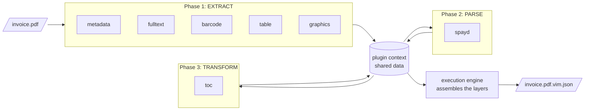

# The Machine That Reads

## A Workshop, Not a Single Machine

A good picture of `vim-parser` is not one big machine with one input and one output. It is
a workshop with specialists. One of them reads the metadata of the file. Another one cuts
the text into blocks. Another one looks for barcodes, another one for tables, another one
for pictures. When the barcode specialist is done, the payment specialist reads the codes
it found. At the end, someone puts the table of contents together from the headings. Each
specialist knows one job and leaves its results on a shared table for the others.

In the code, the specialists are **plugins** and the shared table is the **plugin
context**. The workshop manager is an **orchestrator** that decides who works when.

## Plugins in Packages

The parser is a Java 21 project of more than a dozen Maven modules. The core is a single
"fat" JAR with the command line, the orchestrator and the plugin runtime. Every plugin is a
separate ZIP file in a `plugins/` directory next to it. The plugin runtime is
[PF4J](https://pf4j.org/), a small plugin framework for Java: it finds the ZIP files at
start, loads each one with its own class loader and asks it what it can do.

This design came on the second day of the parser's life, and it was not an accident. A
plugin can be added, replaced or removed without rebuilding the core. The native
lemmatizer backends for Czech, written in C++, live in their own plugins; a deployment that
does not need them simply does not have the ZIP files.

Plugins come in kinds, defined by three extension points of the API module:

| Kind | Extension point | Job | Plugins |
| ---- | --------------- | --- | ------- |
| Extractor | `ExtractorPlugin` | Read raw data from the file | metadata, fulltext, barcode, graphics, table, lemmatizer |
| Parser | `ParserPlugin` | Interpret data that extractors found | spayd |
| Visualizer | `VisualizerPlugin` | Make a view of a finished `vim.json` | html |

The table of contents plugin is an extractor too, but it runs in its own phase,
*transform*, because it builds on the text that other plugins found.

## Who Works When

Each plugin declares which plugins it needs before it can start. The barcode plugin needs
nothing. The SPAYD plugin needs the barcodes. The table of contents needs the full text.
The orchestrator reads these declarations, builds a dependency graph and turns it into an
execution plan, phase by phase. You can ask for the plan without running it. For the
sample invoice of the previous chapter, the parser answers:

```text
VIM Parser - Execution Plan
============================
Input: faktura-2026-0042.pdf (10,9 KB, 1 page)

Discovered plugins: 8
Auto-enabled: 7

Execution sequence:
  Phase 1: EXTRACT
    [1] metadata     (no dependencies)
    [2] fulltext     (no dependencies)
    [3] barcode      (no dependencies)
    [4] table        (no dependencies)
    [5] graphics     (requires: barcode)

  Phase 2: PARSE
    [6] spayd        (requires: barcode)

  Phase 3: TRANSFORM
    [7] toc          (requires: fulltext)

Excluded from auto mode:
    [-] lemmatizer   (autoEnabled=false)
```

This is the output of `auto --dry-run` of version 0.1.8, copied without changes. The
lemmatizer is installed but not enabled by default; it runs only when you ask for
stemming with `--stemming`. That is the meaning of the word *auto* in the command: with
zero configuration, the orchestrator runs every plugin that is enabled by default, in an
order that respects every dependency.



## The Shared Table

Plugins never call each other. They talk through the shared data of the plugin context, a
map from names to values. The text block extractor puts its blocks under `textBlocks`, the
barcode extractor puts its codes under `barcodes`, the SPAYD parser reads `barcodes` and
puts `spaydPayments` back. By default the plugins run one after another; the configuration
file `vim-parser.json` can switch the execution mode to `thread`, and then extractors that do
not depend on each other run in parallel. Either way, the shared map is the only place
where they meet.

When all phases are done, the **execution engine** takes the values from the map and
assembles the `VimDocument`: the physical blocks go to the physical layer, a structural
block is derived from each physical block, the payments go to the semantic layer, the
table of contents to its own layer. Two steps happen only here, after the plugins: the
semantic entities are found by matching block headers against known labels, and every
barcode gets the list of text blocks near it. This is also where `vim_version` is set by
the features the document uses, the habit described in the second chapter.

## Seeing What the Machine Saw

A parser that writes 31 kilobytes of JSON about a one-page invoice needs a way for people
to look at the result. The `html` visualizer turns a `vim.json` into a single HTML page
with tabs for the structural, physical, semantic and table of contents layers, colour-coded
blocks and a switch that hides auxiliary blocks such as page numbers. It runs on a finished
file, so it works for any producer of VIM, not only for this parser:

```bash
portunix vim-parser visualize faktura-2026-0042.pdf.vim.json
```

For the people who maintain the parser, there is a second kind of sight: since March 2026,
the parser can send OpenTelemetry traces, so that the time of each plugin on each document
can be followed in a tracing tool.

## The Same Model in Python

The second chapter told why the parser was ported to Python. Here is what the port looks
like from the inside. The sub-package `ptx_reco.vim` in `portunix-reco` mirrors the Java
modules: an `api` package with the plugin interfaces and the plugin context, a `core`
package with the execution engine, the orchestration and a plugin registry, `extractors`
for barcodes, full text, graphics, the lemmatizer, tables and the table of contents, and
`parsers` with SPAYD. The model classes, nested classes in Java, became module-level Python
dataclasses.

The library map of the translation decides what replaces what: PDFBox, ZXing, Tika and
Lucene give way to their Python counterparts, and Jackson to dataclasses with explicit JSON
serialization. The port also has something the Java parser does not: an OCR extractor that
turns the image of a scanned page into physical blocks with provenance, because reco reads
scans.

The port is the reason why VIM has two implementations today, and why every new layer
must come with a plan for both, as the next chapter explains. The Python side writes the
`extraction` and `prescriptive` layers already; it does not yet read them back, and the
reco pipeline does not yet fill the extraction layer. The contract names reco as the
producer of that layer; the documentation of the port says honestly that this is the
planned state, not the current one.

## A Consumer in Production: Invoices to ISDOC

The clearest example of VIM as a shared model is `portunix-ireco`, a pipeline for
semi-structured documents such as invoices. Its first step, `parse`, runs the execution
engine of `ptx_reco.vim` with the text block extractor and, where possible, the barcode,
table, graphics, table of contents and metadata extractors. The result is a `vim.json` with
the physical and structural layers. The second step, `extract`, reads that file, finds the
fields of the invoice with flexible layout templates and writes them into the semantic
layer of the same file. A third step can export the result to ISDOC, the Czech XML
standard for electronic invoices.

```bash
ptx-ireco parse invoice.pdf -o invoice.vim.json     # PDF → VIM (physical + structural)
ptx-ireco extract invoice.vim.json                  # fills the semantic layer in place
```

Two tools, two steps, one file. Each step adds its layers and leaves the others alone. That
is what the sheets of glass of the first chapter were for.

## Sources

- `plugins/vim-parser` in `portunix-plugins`: module READMEs, `Main.java`, the output of
  `auto --dry-run` and `plugins --deps` of version 0.1.8 (25 October 2026)
- `src/ptx_reco/vim/README.md` in `portunix-reco`
- `README.md` of `portunix-ireco`
- ADR-007 *Port vim-parser to Python via Dream Translation Tool*, `portunix-architecture`
