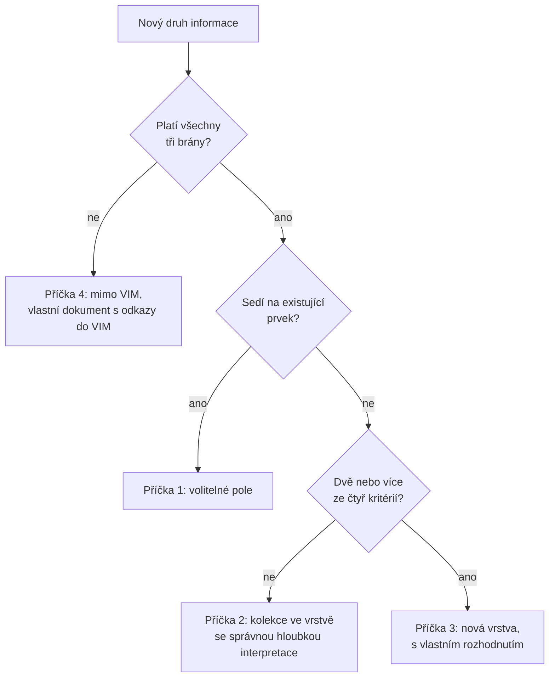

# Slib v JSON Schema

> Český překlad [05-a-promise-in-json-schema.md](05-a-promise-in-json-schema.md). Anglická verze je autoritativní.

## Dvě implementace, jedna pravda

Jakmile měl VIM dvě implementace, javový parser a pythonový port, objevilo se tiché
nebezpečí. Dva týmy mohou číst tutéž specifikaci a pochopit ji trochu jinak. Pole zapsané na
jedné straně jako `rawValue` a na druhé jako `raw_value`; číslo, které jedna strana píše
vždy a druhá jen tehdy, když není prázdné; řetězec verze, který jedna strana kontroluje a
druhá přehlíží. Každý rozdíl je malý. Dohromady dají soubor, který jeden program napíše a
druhý nepřečte.

Odpovědí ekosystému je **kontrakt**: popis formátu, který není kódem v žádném jazyce, který
umí zkontrolovat stroj a který žije na jednom místě. Pro VIM je tím místem tento repozitář,
adresář `contract/schemas/`. Umístilo ho sem rozhodnutí z března 2026, které z VIM udělalo univerzální kontejner. V říjnu 2026 s ním obě
implementace srovnaly své modely a javový parser dostal test, který porovnává jeho model
preskriptivní vrstvy se schématy.

## Co kontrakt obsahuje

Kontrakt VIM je sada souborů JSON Schema v dialektu Draft 2020-12:

| Schéma | Co popisuje |
| ------ | ----------- |
| `vim-document.schema.json` | Kořen: `vim_version`, `document`, `layers` |
| `vim-extraction.schema.json` | Extrakční vrstvu: odkaz na šablonu, zdroje, sloučený dokument |
| `vim-extraction-source.schema.json` | Jeden zdroj vytěžování s jeho původem |
| `vim-extraction-field.schema.json` | Jedno vytěžené pole s hodnotou, surovou hodnotou a revizemi |
| `vim-prescriptive.schema.json` | Preskriptivní vrstvu: definici, odkazy, pojmy |
| `vim-prescriptive-provision.schema.json` | Jedno ustanovení s kotvami, vztahy a ověřením |

Většinu váhy nesou tři pravidla kořenového schématu.

**Objekt `layers` je uzavřený.** Zná přesně šest klíčů, od `physical` po `prescriptive`, a
každý jiný odmítne. Výrobce si nemůže vymyslet vlastní vrstvu; nová vrstva je změnou
kontraktu, o které se rozhoduje veřejně.

**`vim_version` je seznam známých hodnot.** Přijímá verze od `"1.0"` do `"2.1"` a nic
jiného.

**Vrstvy jsou svázané s verzemi.** Dokument s vrstvou `prescriptive` musí říkat `"2.1"`.
Dokument s vrstvou `extraction` musí říkat `"2.0"` nebo `"2.1"`. Toto pravidlo přišlo
16. října 2026 a bylo označeno jako nekompatibilní změna kontraktu: dokumenty, které měly
novou vrstvu se starým číslem verze, dříve prošly a nyní jsou odmítnuty. Skončil tím zvyk
řady 1.x, kdy verze byla seznamem funkcí. V řadě 2.x je verze slibem o tom, jaké vrstvy může
čtenář najít.

## Příklady, které musí projít, a příklady, které musí selhat

Schéma, které se nikdy netestuje, je jen přání. Kontrakt proto přichází s příklady a
pravidla tohoto repozitáře říkají, že každé schéma potřebuje alespoň jeden. Pro VIM existují
dva platné příklady, oba už v této knize zazněly: `form-extraction.vim.json` s jedním
naskenovaným formulářem a `definition-file.vim.json` s definičním souborem a jeho
ustanoveními.

Vedle nich leží v adresáři `contract/examples/invalid/` čtyřicet dokumentů VIM, které musí
**selhat**. Každý porušuje právě jedno pravidlo: kotva na straně nula, spolehlivost větší
než jedna, ustanovení bez ID, odkaz s neznámým rozsahem, klíč vrstvy, který neexistuje,
extrakční vrstva s verzí `"1.5"`. Když někdo pravidlo omylem uvolní, jeden z těchto
dokumentů najednou projde a kontrola selže.

Kontrola je jeden příkaz:

```bash
make validate-contract
```

Najde každý příklad, vybere schéma podle přípony názvu souboru (`.vim.json` jde na
`vim-document.schema.json`) a ohlásí každý výsledek. Několik řádků skutečného běhu:

```text
PASS  [vim-document.schema.json] contract/examples/definition-file.vim.json
PASS  [vim-document.schema.json] contract/examples/form-extraction.vim.json
PASS  [vim-document.schema.json] contract/examples/invalid/anchor-page-zero.vim.json (invalid as expected: /layers/prescriptive/provisions/0/anchors/0/page must be >= 1)
PASS  [vim-document.schema.json] contract/examples/invalid/prescriptive-wrong-vim-version.vim.json (invalid as expected: /vim_version must be equal to constant)
...
98 checked, 0 failed, 8 skipped (no matching contract suffix).
```

## Co JSON Schema neřekne

Některá pravidla jsou mimo dosah JSON Schema. Umí říct, že ustanovení má ID; neumí říct, že
žádná dvě ustanovení nemají stejné ID. Umí říct, že ustanovení vyjmenovává odkazy; neumí
říct, že každý vyjmenovaný odkaz ve stejné vrstvě existuje.

Pro tato pravidla má repozitář malou kontrolu navíc, `scripts/vim-identifier-check.mjs`,
která běží po kontrole schématem nad každým příkladem VIM. Ověří, že `provision_id`,
`reference_id` a `term_id` jsou ve vrstvě jedinečné a že každý odkaz, pojem a vztah
ustanovení ukazuje na něco, co existuje. Její funkce `checkVimIdentifiers()` je exportovaná,
takže ji jiné projekty mohou importovat a uplatnit stejná pravidla na vlastní dokumenty. Ve
výše uvedeném běhu tu selže příklad `provision-reference-without-target.vim.json` se
zprávou *no reference with reference_id 'r-9'*.

## Kdy je něco novou vrstvou?

Uzavřený objekt `layers` otevírá otázku, kterou dříve či později potká každý formát: když
přijde nová informace, kam patří? Čárové kódy se staly kolekcí ve fyzické vrstvě. Obsah
knihy se stal vlastní vrstvou. O každém případu se rozhodovalo zvlášť a architektonické rozhodnutí o nových vrstvách z
října 2026 si všimlo,
že špatné rozhodnutí je drahé oběma směry. Zbytečná vrstva potřebuje schéma tady, oddíl ve
specifikaci, model v Javě, model v Pythonu, podporu ve vizualizéru a zlaté testovací
soubory: jen javový model extrakční vrstvy má 25 tříd a každá vrstva se platí dvakrát.
Chybějící vrstva zase vtlačí cizí model do vrstvy s jiným významem.

Roku 1939 přemýšlel pilot a spisovatel Antoine de Saint-Exupéry v knize *Země lidí* o
tvaru letadel a napsal větu, kterou inženýři rádi citují dodnes:

> Zdá se, že dokonalosti není dosaženo tehdy, když už není co přidat, ale když už není co
> odebrat.

Formát, který chce vydržet, potřebuje stejnou kázeň. Odpovědí VIM je **rozhodovací
žebřík**. Nová informace zvolí první příčku, která sedí:



Tři **brány** rozhodují, zda informace do VIM vůbec patří:

| Brána | Otázka |
| ----- | ------ |
| Porozumění | Je výsledkem porozumění souboru, odvozená z dokumentu a bez něj nedává smysl? |
| Původ | Umí každá položka ukázat na zdroj, stránku, oblast nebo jiný prvek? |
| Užitek | Je užitečná i jinému spotřebiteli než svému výrobci? |

Čtyři **kritéria** rozhodují, zda potřebuje vlastní vrstvu; alespoň dvě musí být „ano“:

| Kritérium | „Ano“ znamená |
| --------- | ------------- |
| Výrobce | Píše ji jiný nástroj, nebo vzniká v jinou dobu než výstup vim-parseru |
| Doménový model | Vyroste ve vlastní model s několika typy entit a vztahy |
| Revize | Její hodnoty se po vytvoření mění: oprava, kontrola, stav |
| Kotvy | Její položky ukazují do více než jedné vrstvy nebo druhu prvků |

Dvě malá pravidla drží počítání poctivé. Když jsou revize jediným důvodem, proč informace
vzniká v jinou dobu, počítají se výrobce a revize jako jedno „ano“. A na kritéria se odpovídá pro příštích dvanáct
měsíců, ne pro každou možnou budoucnost: „možná později“ je „ne“.

Žebřík byl vyzkoušen na historii a výsledek je poučný. Vrstva `extraction` získá tři „ano“ a
vrstvou by se stala znovu. Platby SPAYD nezískají žádné a jsou právem kolekcí. A vrstva
`toc` také nezíská žádné: podle těchto pravidel by byla kolekcí ve strukturální vrstvě.
Vrstvou zůstává, protože přesun by bez užitku rozbil všechny existující čtenáře. Rozhodnutí to říká
otevřeně a dodává, že `toc` není precedentem.

Prvním kandidátem, který vyšplhal celý žebřík, byla vrstva `prescriptive`, která odpověděla
„ano“ na všechny tři brány i všechna čtyři kritéria. Její rozhodnutí také ukazuje, co musí každá
nová vrstva přinést: je volitelná, na jiné vrstvy odkazuje přes ID, místo aby je kopírovala,
její klíč je jedno anglické podstatné jméno malými písmeny, její schéma přichází **před**
jakýmkoli kódem a má plán pro obě implementace.

## Kontrakt je slib cizím lidem

Na kontraktech tohoto repozitáře závisejí jiné projekty a mnoho jejich autorů se s autory
VIM nikdy nepotká. Proto jsou zdejší pravidla ke změnám přísná: každé schéma má vlastní
verzi (`$version`), každá nekompatibilní změna se zapisuje do changelogu tučně a každá změna
schématu přichází s příklady, které projdou, i s příklady, které selžou. Kontrakt je slib
cizím lidem. JSON Schema je jen jazyk, ve kterém je napsán.

Další část knihy opouští nitro VIM a ukazuje, jak ho používat: jak vyrobit `vim.json`,
prohlédnout si ho, zkontrolovat a číst z vlastního kódu.

## Prameny

- [contract/README.md](../../../../contract/README.md) a
  [contract/schemas/README.md](../../../../contract/schemas/README.md) tohoto repozitáře
- [scripts/vim-identifier-check.mjs](../../../../scripts/vim-identifier-check.mjs) a výstup
  `make validate-contract` (25. října 2026)
- [CHANGELOG.md](../../../../CHANGELOG.md): #42 a #51
- ADR-004 a ADR-009, `portunix-architecture`
- Antoine de Saint-Exupéry, *Terre des hommes* (1939, česky *Země lidí*), kapitola III;
  český překlad citátu je vlastní, podle originálu *« Il semble que la perfection soit
  atteinte non quand il n'y a plus rien à ajouter, mais quand il n'y a plus rien à
  retrancher. »*:
  [Terre des hommes](https://www.techno-science.net/fr/definitions/terre-des-hommes)
