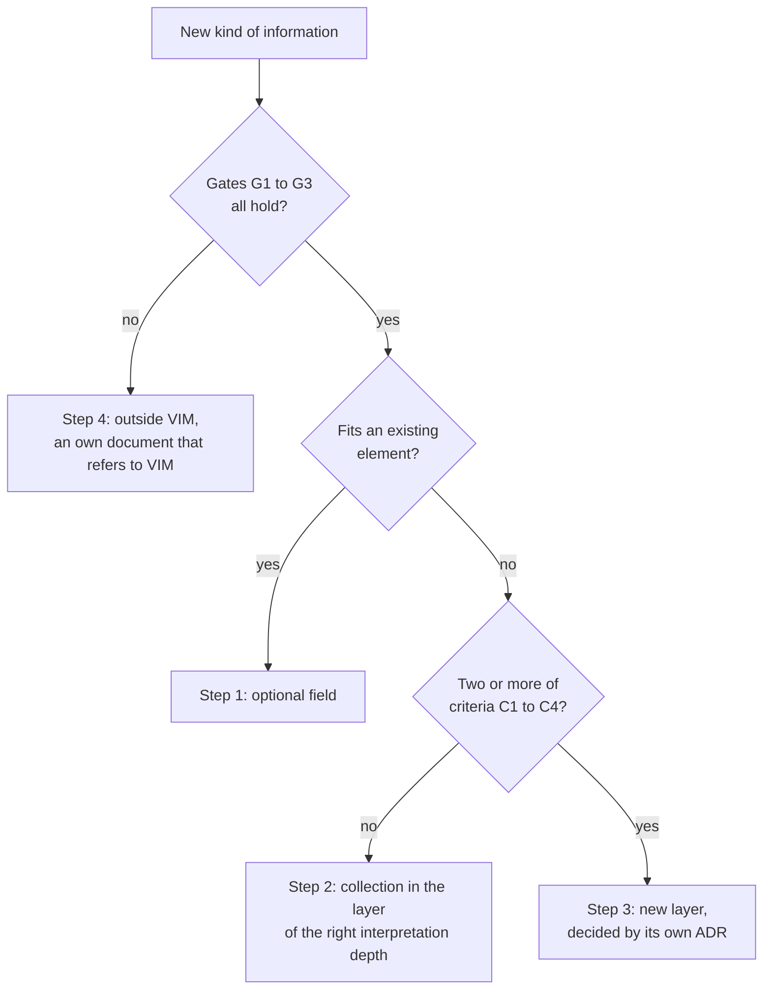

# A Promise in JSON Schema

## Two Implementations, One Truth

Once VIM had two implementations, a Java parser and a Python port, a quiet danger
appeared. Two teams can read the same specification and understand it a little
differently. A field written as `rawValue` on one side and `raw_value` on the other; a
number that one side writes always and the other side only when it is not empty; a version
string that one side checks and the other side ignores. Each difference is small. Together
they make a file that one program writes and the other cannot read.

The answer of the ecosystem is a **contract**: a description of the format that is not
code in any language, that a machine can check, and that lives in one place. For VIM that
place is this repository, the directory `contract/schemas/`. ADR-004 decided it in March
2026. In October 2026 both implementations aligned their models with it, and the Java
parser got a test that compares its model of the prescriptive layer with the schemas.

## What the Contract Holds

The contract of VIM is a set of JSON Schema files in the Draft 2020-12 dialect:

| Schema | What it describes |
| ------ | ----------------- |
| `vim-document.schema.json` | The root: `vim_version`, `document`, `layers` |
| `vim-extraction.schema.json` | The extraction layer: template reference, sources, merged document |
| `vim-extraction-source.schema.json` | One source of an extraction with its provenance |
| `vim-extraction-field.schema.json` | One extracted field with its value, raw value and revisions |
| `vim-prescriptive.schema.json` | The prescriptive layer: definition, references, terms |
| `vim-prescriptive-provision.schema.json` | One provision with anchors, relations and verification |

Three rules of the root schema carry most of the weight.

**The `layers` object is closed.** It knows exactly six keys, from `physical` to
`prescriptive`, and rejects any other. A producer cannot invent a layer of its own; a new
layer is a change of the contract, decided in the open.

**`vim_version` is a list of known values.** It accepts the versions from `"1.0"` to
`"2.1"` and nothing else.

**Layers are bound to versions.** A document with the `prescriptive` layer must say
`"2.1"`. A document with the `extraction` layer must say `"2.0"` or `"2.1"`. This rule came
on 16 October 2026 and was marked as a breaking change of the contract: documents that had
a new layer with an old version number validated before and are rejected now. It ended the
1.x habit of the version as a list of features. In 2.x, the version is a promise about
which layers a reader may find.

## Examples That Must Pass and Examples That Must Fail

A schema that is never tested is a wish. The contract therefore comes with examples, and
the rules of this repository say that every schema needs at least one. For VIM there are
two valid examples, both already met in this book: `form-extraction.vim.json` with one
scanned form and `definition-file.vim.json` with a definition file and its provisions.

Next to them, the directory `contract/examples/invalid/` holds forty VIM documents that
must **fail**. Each one breaks exactly one rule: an anchor on page zero, a confidence above
one, a provision without an ID, a reference with an unknown scope, a layer key that does
not exist, an extraction layer with the version `"1.5"`. When someone loosens a rule by
mistake, one of these documents suddenly passes, and the check fails.

The check is one command:

```bash
make validate-contract
```

It finds every example, picks the schema by the suffix of the file name (a `.vim.json`
goes to `vim-document.schema.json`), and reports each result. A few lines of a real run:

```text
PASS  [vim-document.schema.json] contract/examples/definition-file.vim.json
PASS  [vim-document.schema.json] contract/examples/form-extraction.vim.json
PASS  [vim-document.schema.json] contract/examples/invalid/anchor-page-zero.vim.json (invalid as expected: /layers/prescriptive/provisions/0/anchors/0/page must be >= 1)
PASS  [vim-document.schema.json] contract/examples/invalid/prescriptive-wrong-vim-version.vim.json (invalid as expected: /vim_version must be equal to constant)
...
98 checked, 0 failed, 8 skipped (no matching contract suffix).
```

## What JSON Schema Cannot Say

Some rules are beyond JSON Schema. It can say that a provision has an ID; it cannot say
that no two provisions have the same ID. It can say that a provision lists references; it
cannot say that each listed reference exists in the same layer.

For these rules, the repository has a small extra check, `scripts/vim-identifier-check.mjs`,
which runs after the schema check on every VIM example. It verifies that `provision_id`,
`reference_id` and `term_id` are unique in the layer, and that every reference, term and
relation of a provision points to something that exists. Its function
`checkVimIdentifiers()` is exported, so other projects can import it and apply the same
rules to their own documents. In the run above, the example
`provision-reference-without-target.vim.json` fails here with the message
*no reference with reference_id 'r-9'*.

## When Is Something a New Layer?

The closed `layers` object raises a question that every format meets sooner or later: when
new information arrives, where does it go? Barcodes became a collection inside the physical
layer. The table of contents became a layer of its own. Each decision was made alone, and
ADR-009 noticed that a wrong decision is expensive in both directions. An unnecessary layer
needs a schema here, a section in the specification, a model in Java, a model in Python,
support in the visualizer and golden test files: the Java model of the extraction layer
alone has 25 classes, and every layer is paid for twice. A missing layer, on the other
hand, presses a foreign model into a layer with another meaning.

The answer is a **decision ladder**. New information takes the first step that fits:



The three **gates** decide whether the information belongs to VIM at all:

| ID | Gate |
| --- | ---- |
| G1 | It is a result of understanding the file: derived from the document, meaningless without it |
| G2 | Every item can carry provenance: a source, a page, a region or the ID of another element |
| G3 | It is useful to a consumer other than its producer |

The four **criteria** decide whether it needs a layer of its own; at least two must be
"yes":

| ID | Criterion |
| --- | --------- |
| C1 | It has a different producer or life cycle than the output of vim-parser |
| C2 | It will grow into its own domain model with several entity types and relations |
| C3 | It will have revisions or state: values change after production |
| C4 | It anchors into more than one layer or kind of element |

Two small rules keep the count honest. When revisions are the only reason for a different
life cycle, C1 and C3 count as one "yes". And the criteria are answered for the next twelve
months, not for every possible future: "maybe later" is a "no".

The ladder was tested against history, and the result is instructive. The `extraction`
layer scores three "yes" and would be a layer again. The SPAYD payments score none and are
rightly a collection. And the `toc` layer scores none: under these rules it would be a
collection in the structural layer. It stays a layer, because moving it would break every
existing reader for no gain. The ADR says so plainly and adds that `toc` is not a
precedent.

The first candidate to climb the whole ladder was the `prescriptive` layer, which answered
"yes" to all three gates and all four criteria. Its ADR also shows what every new layer
must bring: it is optional, it refers to other layers by ID instead of copying them, its
key is one lower-case English noun, its schema comes **before** any code, and it has a plan
for both implementations.

## A Contract Is a Promise to Strangers

Other projects depend on the contracts of this repository, and many of their authors will
never meet the authors of VIM. That is why the rules here are strict about change: every
schema has a version of its own (`$version`), every breaking change is written into the
changelog in bold, and every schema change comes with examples that pass and examples that
fail. A contract is a promise to strangers. JSON Schema is only the language in which it is
written.

The next part of the book leaves the inside of VIM and shows how to use it: how to make a
`vim.json`, look at it, check it and read it from your own code.

## Sources

- [contract/README.md](../../../../contract/README.md) and
  [contract/schemas/README.md](../../../../contract/schemas/README.md) of this repository
- [scripts/vim-identifier-check.mjs](../../../../scripts/vim-identifier-check.mjs) and the
  output of `make validate-contract` (25 October 2026)
- [CHANGELOG.md](../../../../CHANGELOG.md): #42 and #51
- ADR-004 and ADR-009, `portunix-architecture`
